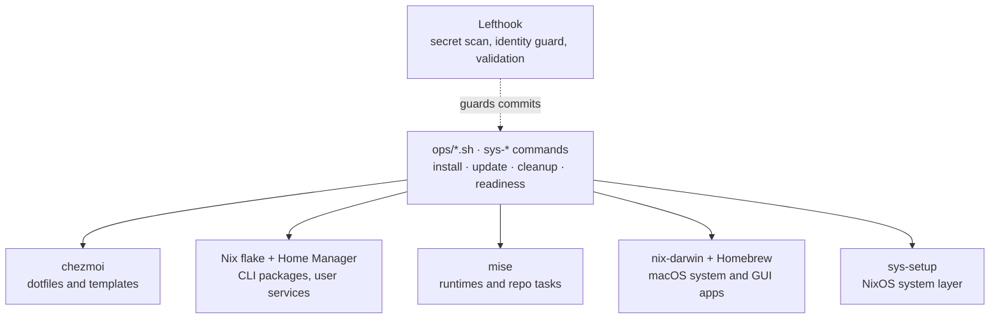

<div align="center">

# app-configs

**Reproducible dotfiles and development environment for NixOS, Linux, macOS and WSL2.**

Declarative packages, runtimes, Homebrew apps and system maintenance, built on
Nix flakes, Home Manager, nix-darwin, chezmoi and mise, with a fish shell
setup, Lefthook Git hooks and Bats-tested scripts.

[Quick start](#quick-start) · [Systems](#supported-systems) ·
[Architecture](#how-it-fits-together) · [Commands](#commands) ·
[Recovery](#recovery) · [Docs](#documentation)

</div>

> [!WARNING]
> This is a personal configuration. The automated installer applies changes by
> default and overwrites existing dotfiles with `chezmoi apply --force`, after
> snapshotting the files it is about to replace. Preview first with `DRY_RUN=1`.

## What it provides

- **One entry point for a clean machine.** `ops/install.sh` bootstraps Nix,
  Home Manager, chezmoi and mise, applies everything, and is safe to re-run.
- **One owner per concern.** Dotfiles, CLI packages, runtimes, macOS apps,
  the NixOS system layer and Git hooks each belong to exactly one tool.
- **Separate preview and apply paths.** Install, update, system setup, cleanup
  and uninstall each have a mode that only reports what would change.
- **Recovery points.** Managed files are snapshotted before every apply, and
  `sys-update rollback` restores the previous Home Manager generation and
  `flake.lock`.
- **Checks that say where you stand.** `sys-readiness`, `ops/doctor.sh`,
  `ops/validate-config.sh`, Bats tests and Git hooks (secret scan, identity
  guard, config validation).

## Quick start

Requires Git, Bash and internet access. `sudo` is needed only for the NixOS
system layer. The installer bootstraps or verifies everything else.

```bash
git clone https://github.com/UtmostCreator/app-configs.git ~/app-configs
cd ~/app-configs
DRY_RUN=1 bash ops/install.sh   # preview: prints the plan, changes nothing
bash ops/install.sh             # install + apply (unattended, no sudo, idempotent)
sudo sys-setup --apply          # NixOS only, once: login shell, trusted-users, GC, rebuild
exec fish                       # start a new shell so the login shell applies
sys-readiness                   # done when it prints ALL SET
```

`sys-readiness` reports `ALL SET` (done), `system rebuild pending` (run
`sudo sys-setup --apply`) or `NOT READY` (re-run the installer). The `sys-*`
commands exist in `~/.local/bin` only after the first install.

If `home/.chezmoidata/personal.yaml` is missing, the installer seeds it from
the example and leaves Git identity unset until you edit it.

<details>
<summary><strong>Manual mode: step by step, dry-run by default</strong></summary>

```bash
mkdir -p home/.chezmoidata
cp home/personal.yaml.example home/.chezmoidata/personal.yaml
$EDITOR home/.chezmoidata/personal.yaml
bash ops/bootstrap.sh           # dry-run, no mutations
bash ops/bootstrap.sh --yes     # install + apply
```

```yaml
name: "Your Full Name"
email: "you@example.com"
signingKey: ""                  # optional git signing key
minimal: false                  # true = minimal VS Code settings
useGitDelta: true               # git-delta in .gitconfig
hostProfile: "linux-desktop"    # see Supported systems
gui: true                       # GUI configs (ghostty, etc.)
```

`personal.yaml` is gitignored and must never be committed; a pre-commit hook
rejects it. Full runbook: [`bootstrap.md`](docs/getting-started/bootstrap.md).

</details>

## Supported systems

| System | `hostProfile` | Nix layer | GUI default |
|--------|---------------|-----------|:-----------:|
| NixOS (daily driver) | `linux-desktop` | Home Manager standalone + `sys-setup` system layer | yes |
| Other Linux desktop | `linux-desktop` | Home Manager standalone | yes |
| Linux CLI / headless | `linux-cli` | Home Manager standalone | no |
| macOS (Apple Silicon) | `macos` | nix-darwin + Home Manager + Homebrew casks | yes |
| WSL2 | `wsl` | Home Manager standalone, no Windows-side management | no |

Native Windows is not supported; use WSL2. Override `gui` in `personal.yaml`
when a machine differs from its profile's default.

## How it fits together

The tools own parallel concerns; they are not a pipeline.



Rationale and boundaries: [`tool-ownership.md`](docs/architecture/tool-ownership.md).

## Commands

| Command | Changes things? | What it does |
|---------|:---------------:|--------------|
| `sys-readiness` | no | Is this host fully configured? |
| `bash ops/update-all.sh` | no | Report the full update plan |
| `sys-update` | **yes** | Update apps, CLI packages, dotfiles and hooks |
| `sys-update rollback` | **yes** | Restore the previous Home Manager generation + `flake.lock` |
| `sys-update-log` | no | Show the last update run's log (fish) |
| `sys-setup` / `sudo sys-setup --apply` | no / **yes** | Preview / apply the NixOS system layer and rebuild |
| `sys-cleanup` | **yes** | De-dup the Nix store and prune caches; keeps all rollbacks |
| `sys-cleanup --gc` | **yes** | Also remove aged generations; keeps recent rollbacks |
| `mise run sync` / `sync:apply` | no / **yes** | Preview / snapshot + apply chezmoi, HM/darwin, mise, VS Code extensions, Lefthook |
| `mise run apply` | **yes** | chezmoi only, no Nix or mise side effects |
| `mise run doctor` / `repo:check` | no | Health check / doctor + validator + optional flake check |
| `bash ops/uninstall.sh [--apply]` | no / **yes** | Report / remove; never removes Nix or snapshots |

Each `sys-*` command wraps an `ops/*.sh` script and has a `mise run` equivalent
(`install`, `update:apply`, `cleanup:apply`, `readiness`). Optional extras
(dive, fx, navi, glow, gum): `mise run tools:optional:install`.

`sys-readiness` is opinionated: on NixOS it also expects fish as the login
shell, a system GC timer, the `Europe/London` time zone and Tailscale.

## Recovery

What the safety net covers, and what it does not:

- **Snapshots cover chezmoi-managed files only**, copied to
  `~/.local/state/dotfiles-snapshots/<UTC timestamp>/` with a `MANIFEST.txt`.
  They are not a backup of `$HOME`. Restore by hand:
  `cp -a <snapshot>/. ~/`.
- **`sys-update` refuses to start** on a dirty worktree (`--allow-dirty`
  overrides) or when a managed file was edited by hand: port the edit into
  `home/`, or let the repo win with `--force`.
- **`sys-update rollback`** restores the previous Home Manager generation and
  `flake.lock`, and prints the snapshot path for dotfiles, which you restore
  manually.
- **Cleanup keeps rollbacks.** `sys-cleanup` never removes generations;
  `--gc` removes only those older than `KEEP_DAYS`.

## Repository layout

<details>
<summary><strong>Directories and root config files</strong></summary>

| Path | Purpose |
|------|---------|
| `home/` | chezmoi source tree. `personal.yaml.example` is tracked; the real `.chezmoidata/personal.yaml` is gitignored. |
| `nix/` | Flake and Home Manager modules. Exposes `homeConfigurations.{linux-desktop,linux-cli,wsl,macos}` and `darwinConfigurations.macos`. |
| `ops/` | Install, setup, update, cleanup and validation scripts, Git hooks (`ops/hooks/`), project helpers. |
| `tests/bash/` | Bats suites for the `ops/` scripts. |
| `docs/` | Canonical documentation. Start at [`docs/index.md`](docs/index.md). |
| `repo-docs/` | Legacy docs still read by `ops/` scripts; moves once those are updated. |
| `mise.toml` / `.lefthook.yml` | Repo tasks / Git hooks. Per-user tool versions live in `home/dot_config/mise/config.toml.tmpl`. |

`.editorconfig`, `.prettierrc`, `.eslintrc.json`, `.stylelintrc.json` and
`.gitattributes` are style references for downstream projects, not runtime
behaviour.

</details>

## Troubleshooting

<details>
<summary><strong>Common problems</strong></summary>

| Problem | Fix |
|---------|-----|
| `sys-*` command not found | Run `bash ops/install.sh`, then open a new shell |
| Shell did not change to fish | `exec fish`, or reopen the terminal; on NixOS run `sudo sys-setup --apply` |
| Readiness says `system rebuild pending` | `sudo sys-setup --apply` (NixOS) |
| Readiness says `NOT READY` | Re-run `sys-install`, then `sys-readiness` |
| `sys-update` stops on hand-edited files | Port the edit into `home/`, or `sys-update --force` to discard it |
| macOS GUI apps missing | Check the Homebrew / nix-darwin setup |
| WSL2 GUI missing | Expected; WSL2 is CLI only |

</details>

## Documentation

| Read | For |
|------|-----|
| [`docs/index.md`](docs/index.md) | The documentation map, by task |
| [`install.md`](docs/getting-started/install.md) | Install and maintenance guide |
| [`bootstrap.md`](docs/getting-started/bootstrap.md) | Cold-start runbook |
| [`nixos/install.md`](docs/platforms/nixos/install.md) · [`rebuild.md`](docs/platforms/nixos/rebuild.md) | NixOS specifics; when and how to run `nixos-rebuild` |
| [`nix-package-replacements.md`](docs/reference/nix-package-replacements.md) | Nix-specific packages and cross-distro replacements |
| [`SECURITY.md`](SECURITY.md) | Reporting a security issue |
