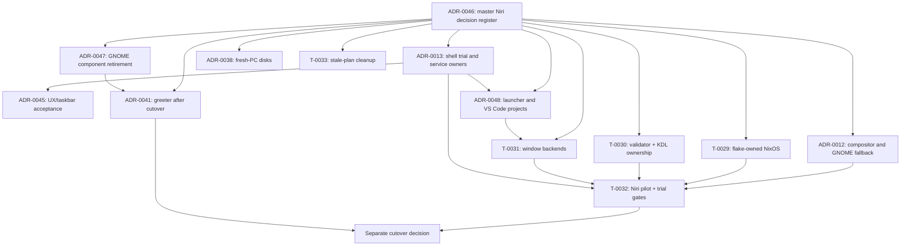

# ADR-0046: Niri desktop migration: central installation decisions, component owners and gaps
Status: partly-decided (central **inventory**, not an approval to install, select a shell or cut over) · Date: 2026-11-22 · Sources: ADR-0012/0013/0038/0041/0045; T-0029–T-0033; `docs/plans/niri-migration.md`, `docs/plans/niri-two-pc-pilot.md`, and the pilot Nix configuration.

## Purpose and authority

This is the **entry point for the Niri desktop migration**: one place to discover every required or desired install component, what was selected, what is merely proposed, which file owns it, why, how to validate it, and what remains undecided. It **does not replace** the rationale or acceptance criteria of the linked ADRs and tickets. If a component's owner ADR says `proposed` or `trial`, this inventory **cannot** silently promote it to `decided`.

**New design direction (2026-11-22):** Prefer a **GNOME-minimal Niri desktop**, but retain a GNOME component only when its required feature has **not been matched or exceeded by a verified alternative**, or while it is needed for the safe GNOME fallback. This is not permission to remove the currently working desktop, portal or greeter. **Tuigreet is the leading future greeter candidate, gtkgreet the graphical competitor; Vicinae is only the incumbent launcher pending a feature comparison, not a presumed permanent winner.** Owner comparisons: [ADR-0047](0047-gnome-dependency-retirement-and-wayland-components.md), [ADR-0041](0041-login-greeter-gdm-greetd-tuigreet-regreet.md), [ADR-0048](0048-niri-launcher-vscode-project-workflows.md).

**Read statuses literally:**
- **Selected** = explicitly decided for the stated **phase**, not proof of installation.
- **Declared** = present in committed Nix/chezmoi configuration; **does not** prove installed on a physical machine.
- **VM-checked** = the existing pilot VM test exercised a narrow subset; **does not** prove GPU, outputs, suspend, apps or cutover.
- **Trial** = evaluation order approved, **not** a permanent component choice.
- **Proposed** = candidate only. **—** = **no permanent selection recorded**, deliberately blank; a gap entry below owns the decision.
- **Inherited** = currently packaged/configured for the Linux desktop profile, not a fresh Niri-specific selection.
- **Pending verification** = untested in the intended real desktop session.

Never equate "in `nixpkgs`", "documented upstream", "module enabled in PC 2 config", "built in QEMU", "installed on PC 2" and "selected for PC 1 cutover".

## Scope and sequencing

1. **Present PC 1:** live GNOME + GDM + Vicinae, existing `/etc/nixos#nixos` configuration. **Do not change** it based on this ADR.
2. **Build-only PC 2 pilot:** `nixosConfigurations.linux-desktop-pilot` already exists; `nix/tests/pilot-vm.nix` checks GDM/GNOME and a Niri login/IPС without a real GPU output. The pilot's `/boot` and root filesystems are placeholders **not a ready-to-install disk specification**.
3. **Physical PC 2:** requires verified hardware and disk layout, a reviewed install plan, backup/recovery as applicable, and explicit approval; compare Dux then Noctalia only after the shell activation gate.
4. **PC 1 NixOS ownership change:** separate T-0029 step, keep GNOME initially. Back up `/etc/nixos` and mutable home data, prove rollback, and obtain approval before any live activation.
5. **PC 1 Niri as optional session:** T-0032 and T-0031 parity; GNOME remains default. Only after **2–4 weeks of usable daily trial** and a separate approval may Niri become default. Shell, greeter and GNOME removal are separate decisions.

### Decision hierarchy
- **Compositor/session:** [ADR-0012](0012-desktop-compositor-gnome-niri-hyprland.md); [T-0029](../../work/active/T-0029-nixos-system-ownership/ticket.md), [T-0032](../../work/active/T-0032-niri-trial-session/ticket.md).
- **Shell, status/taskbar, notifications, lock/idle:** [ADR-0013](0013-desktop-shell-bar-notifications-trial.md); feature criteria [ADR-0045](0045-niri-windows-like-desktop-shell-ux.md).
- **Login/greeter:** [ADR-0041](0041-login-greeter-gdm-greetd-tuigreet-regreet.md).
- **Fresh-PC installation/disk:** [ADR-0038](0038-disko-nixos-anywhere-fresh-hosts.md); [two-PC plan](../../plans/niri-two-pc-pilot.md).
- **Keyboard, apps and window actions:** [ADR-0027](0027-launcher-clipboard-windows-input-macos-ux.md); [T-0031](../../work/active/T-0031-compositor-neutral-window-actions/ticket.md).
- **Screenshot/files/backup:** [ADR-0036](0036-screenshots-media-images-and-pdf.md), [ADR-0028](0028-files.md), [ADR-0033](0033-communication-sync-notes-and-backup.md); [T-0032](../../work/active/T-0032-niri-trial-session/ticket.md).
- **Validation/document drift:** [T-0030](../../work/active/T-0030-validator-nixos-programs-and-niri/ticket.md), [T-0033](../../work/active/T-0033-refresh-stale-migration-docs/ticket.md).

## Installation decision matrix

**Columns:** the PC 2 entry describes the **repo's declared build-only pilot** unless otherwise stated. The future column is a **permanent selection** only when explicitly supported by another ADR. **—** means deliberately undecided; it must remain empty until an owner decision. The status column identifies the corresponding decision or implementation stage, not deployment success. Links point to the owner decision/ticket or committed configuration.

### A. Foundation, installation and login

| Component / required function | PC 2 pilot / current state | Permanent Niri target | State / why / reference |
|---|---|---|---|
| OS and host profile | NixOS `linux-desktop-pilot`, **declared**, VM-tested subset | NixOS `linux-desktop` for PC 1 after takeover | **Selected architecture, not activated**; isolate risk using PC 2 first. [T-0029](../../work/active/T-0029-nixos-system-ownership/ticket.md), [two-PC plan](../../plans/niri-two-pc-pilot.md) |
| Disk layout / filesystems | Placeholder root `/dev/disk/by-label/nixos`, `/boot` by label; **not usable as an install decision** | **—** | **P0 gap G01**: real device identifiers, generated hardware config, ESP, partitions, filesystem and boot. [ADR-0038](0038-disko-nixos-anywhere-fresh-hosts.md), [pilot system](../../../nix/hosts/linux-desktop-pilot/system.nix) |
| Encryption / swap / recovery media | **—** | **—** | **P0 G01** before destructive physical install; LUKS/swap/recovery still proposals. [ADR-0038](0038-disko-nixos-anywhere-fresh-hosts.md) |
| Bootloader | `systemd-boot` + EFI declared for PC 2 | **—** (must preserve PC 1's actual boot/dual-boot config) | **Declared, hardware not verified**; [pilot system](../../../nix/hosts/linux-desktop-pilot/system.nix), [T-0029](../../work/active/T-0029-nixos-system-ownership/ticket.md) |
| NixOS system owner | Repo flake for PC 2; PC 1 still `/etc/nixos#nixos` | Repo `nixosConfigurations.linux-desktop` | **Partly implemented**; single `flake.lock`/writer and hardware preservation remain. [T-0029](../../work/active/T-0029-nixos-system-ownership/ticket.md) |
| Display/login manager | **GDM**, enabled | **—** (preference **greetd + tuigreet**; graphical competitor **gtkgreet**; ReGreet richer comparator) | **GDM selected only for existing safe trial**; future target unapproved; keep GNOME fallback until separate recovery decision. [ADR-0041](0041-login-greeter-gdm-greetd-tuigreet-regreet.md), [ADR-0047](0047-gnome-dependency-retirement-and-wayland-components.md) |
| Default login session | **GNOME**, explicitly set | **—** (Niri default requires separate cutover approval) | **Selected for trial**; avoids NixOS Niri module's `mkDefault "niri"`. [pilot system](../../../nix/hosts/linux-desktop-pilot/system.nix), [T-0032](../../work/active/T-0032-niri-trial-session/ticket.md) |
| Compositor | **Niri** from nixpkgs `programs.niri.enable` as additional session | Niri is the **trial target**, not approved as default | **Selected for evaluation**; Hyprland deferred, GNOME fallback. [ADR-0012](0012-desktop-compositor-gnome-niri-hyprland.md), [T-0032](../../work/active/T-0032-niri-trial-session/ticket.md) |
| Session startup, user services | `niri-session` / systemd via module; shell autostart intentionally absent | **—** (session-scoped units only) | **Partly declared; P0 G02**; no duplicate `spawn-at-startup` or GNOME-leaking units. [T-0032](../../work/active/T-0032-niri-trial-session/ticket.md) |
| GNOME fallback | GNOME + GDM both present | Keep until separate cutover/retirement decision | **Selected for safe trial**, not guaranteed permanently. [ADR-0012](0012-desktop-compositor-gnome-niri-hyprland.md), [ADR-0041](0041-login-greeter-gdm-greetd-tuigreet-regreet.md) |
| Niri user configuration owner | **chezmoi** `home/dot_config/niri/config.kdl` | Same owner unless explicitly amended | **Selected and committed**, not HM or `/etc/niri`. [T-0030](../../work/active/T-0030-validator-nixos-programs-and-niri/ticket.md), [Niri KDL](../../../home/dot_config/niri/config.kdl) |
| XWayland for X11 applications | `xwayland-satellite` installed as a system package | Same approach under Niri, unless trial finds a blocker | **Declared, VM startup checked**. [pilot system](../../../nix/hosts/linux-desktop-pilot/system.nix), [T-0032](../../work/active/T-0032-niri-trial-session/ticket.md) |
| Authentication/password prompts (polkit) | **Soteria** `security.soteria.enable` | **—** (one polkit agent; do not also start a shell agent) | **Selected for PC 2 pilot only**, VM service check; **P0 G03** for final ownership. [pilot system](../../../nix/hosts/linux-desktop-pilot/system.nix), [ADR-0013](0013-desktop-shell-bar-notifications-trial.md) |
| Portal backend and screencast | `programs.niri` brings GNOME/GTK portal integration | Existing GNOME/GTK portals unless live evidence rejects them | **Declared, not GPU-verified**; [T-0032](../../work/active/T-0032-niri-trial-session/ticket.md) |
| Secrets service at login | GNOME keyring through Niri module; KeePassXC is personal password manager | Keep if apps/portal need it; **—** after greeter cutover for PAM integration | **Declared/trial**; do not confuse keyring with KeePassXC. [ADR-0023](0023-password-managers-and-secrets-cli.md), [ADR-0041](0041-login-greeter-gdm-greetd-tuigreet-regreet.md) |

### B. Desktop interface, taskbar and interaction

| Component / required function | PC 2 pilot / current state | Permanent Niri target | State / why / reference |
|---|---|---|---|
| Complete desktop shell | **—** (no bar or shell activated) | **—** | **Trial order selected: Dux → Noctalia**; iNiR additional *proposed* trial; Waybar stack fallback. **P0 G04**, [ADR-0013](0013-desktop-shell-bar-notifications-trial.md), [ADR-0045](0045-niri-windows-like-desktop-shell-ux.md) |
| Bottom taskbar / running apps / pins | **—** | **—** | **P0 G04**, explicit window focus, per-window close, running indicator, grouping and multi-instance switching before visual polish. [ADR-0045](0045-niri-windows-like-desktop-shell-ux.md) |
| Dock position / auto-hide / icon groups | **—** | **—** | **P1 G04**; bottom preferred, any edge/Island acceptable if demonstrably better. [ADR-0045](0045-niri-windows-like-desktop-shell-ux.md) |
| Window hide/show, restore, close | Existing GNOME helpers only; Niri backend **not implemented** | **—** (Niri has no native minimise; scratchpad/parking must be tested) | **P0 G05**, MRU focus and semantics [T-0031](../../work/active/T-0031-compositor-neutral-window-actions/ticket.md), [ADR-0045](0045-niri-windows-like-desktop-shell-ux.md) |
| Window search, app launcher, keyboard command menu | **Vicinae** in Linux desktop HM profile; Niri KDL binds launcher | **—** (Vicinae incumbent; compare Walker, Albert, Ulauncher, Rofi and shell launchers) | **P1 G23** feature-first replacement; preserve VS Code recent project opening, exact window focus, scripts and clipboard. [ADR-0048](0048-niri-launcher-vscode-project-workflows.md), [Vicinae HM](../../../nix/modules/home/vicinae.nix), [T-0031](../../work/active/T-0031-compositor-neutral-window-actions/ticket.md) |
| Clipboard command tools | `wl-clipboard` inherited | `wl-clipboard` | **Inherited** from GNOME profile, no independent history UI. [GUI HM](../../../nix/modules/home/gui.nix) |
| Clipboard **history UI/provider** | Vicinae used in current GNOME workflow; shell history disabled during comparison | **—** (Vicinae strongly preferred, ADR-0013 still records owner as open) | **P1 G06**; resolve contradiction between later pilot-plan wording and ADR-0013, then ensure **one provider**. [ADR-0013](0013-desktop-shell-bar-notifications-trial.md), [two-PC plan](../../plans/niri-two-pc-pilot.md) |
| Notifications / history / Do Not Disturb | **—** | **—** | **P0 G03**; select exactly one DBus notification owner (Dux, Noctalia or SwayNC), test Telegram/Vesktop. [ADR-0013](0013-desktop-shell-bar-notifications-trial.md), [T-0032](../../work/active/T-0032-niri-trial-session/ticket.md) |
| System tray / app indicators | **—** (GNOME uses AppIndicator in existing session) | **—** | **P0 G03**; taskbar or shell must supply real tray, no GNOME-only extension dependency. [ADR-0013](0013-desktop-shell-bar-notifications-trial.md), [GUI HM](../../../nix/modules/home/gui.nix) |
| Lock screen / idle / suspend protection | **—** (default example `swaylock` disabled in KDL) | **—** | **P0 G03**; choose one locker and one idle controller, test hotplug, lock/unlock and suspend; do not activate both shell and swaylock/swayidle unreviewed. [T-0032](../../work/active/T-0032-niri-trial-session/ticket.md), [ADR-0013](0013-desktop-shell-bar-notifications-trial.md) |
| Power menu / logout / shutdown / restart | GDM/desktop baseline only | **—** | **P1 G07**; confirm safe session actions in final shell and greeter. [ADR-0013](0013-desktop-shell-bar-notifications-trial.md), [ADR-0041](0041-login-greeter-gdm-greetd-tuigreet-regreet.md) |
| Network, Bluetooth, brightness, media controls / OSD | NetworkManager enabled PC 2; shell UI **—** | **—** | **P1 G07**; system service and desktop control surface are distinct. [pilot system](../../../nix/hosts/linux-desktop-pilot/system.nix), [ADR-0013](0013-desktop-shell-bar-notifications-trial.md) |
| Widgets, themes, wallpaper, icons/cursor, night light | **—** | **—** | **P2 G08**; evaluate after core window controls work; options exist in shell ecosystems, none selected. [ADR-0045](0045-niri-windows-like-desktop-shell-ux.md) |
| Plugin system, IPC and runtime updates | **—** | **—** | **P1 G09**; select deterministic/pinned and offline-capable update ownership after shell selection. [ADR-0045](0045-niri-windows-like-desktop-shell-ux.md) |

### C. Input, media, applications and hardware

| Component / required function | PC 2 pilot / current state | Permanent Niri target | State / why / reference |
|---|---|---|---|
| Keyboard languages / layout switching | **US + Russian**, `grp:win_space_toggle`, from KDL | Same | **Selected/committed**, physical bindings require human test. [KDL](../../../home/dot_config/niri/config.kdl), [T-0032](../../work/active/T-0032-niri-trial-session/ticket.md) |
| Global shortcuts and app toggles | Essential Niri KDL bindings; GNOME helper currently active | **—** pending Niri backend for MRU/app focus/resize and bilingual parity | **P0 G05**; do not duplicate GNOME-only DBus logic. [T-0031](../../work/active/T-0031-compositor-neutral-window-actions/ticket.md) |
| Multi-monitor layout / hybrid GPU / scaling | Niri session VM check only; actual monitor/GPU not exercised | **—** until real outputs and driver testing | **P0 G10**; hotplug, mixed DPI and AMD/NVIDIA (nouveau). [T-0032](../../work/active/T-0032-niri-trial-session/ticket.md), [desktop stability](../../platforms/nixos/desktop-stability.md) |
| Screenshots / region / pin | **Flameshot** inherited from GNOME; Niri alternative **—** | **—** until live multi-output screenshot reproduction | **P0 G11**; consider Niri native action or grim/slurp/satty only if necessary. [ADR-0036](0036-screenshots-media-images-and-pdf.md), [T-0032](../../work/active/T-0032-niri-trial-session/ticket.md) |
| Screen sharing, recording, portal selectors | XDG portals from Niri module; practical selection **—** | **—** until monitor/window share works after hotplug/suspend | **P0 G11**, including Vesktop/Brave and file dialog. [T-0032](../../work/active/T-0032-niri-trial-session/ticket.md) |
| File chooser | GNOME portal and Nautilus available (Niri module's `useNautilus` default; not explicitly pinned in pilot) | **—** if another chooser is preferable | **P1 G12**; test dialogs across desktop apps. [T-0032](../../work/active/T-0032-niri-trial-session/ticket.md) |
| File manager | Nautilus + **Double Commander** in existing Linux desktop environment | Keep existing apps; **—** as the preferred Niri taskbar/files default | **Inherited**, preference/mime decision open. [ADR-0028](0028-files.md), [GUI HM](../../../nix/modules/home/gui.nix) |
| Sound and microphone | Retain existing audio stack (no Niri-specific replacement) | Same, add shell OSD **—** | **Inherited**, live checks P0; [T-0032](../../work/active/T-0032-niri-trial-session/ticket.md) |
| Terminal, browser, editor | **Ghostty**, **Brave** (default), Firefox, VS Code from existing profile | Retain; Niri-specific app/window rules **—** | **Inherited**, no new app selection implied. [ADR-0022](0022-browsers.md), [ADR-0025](0025-terminal-environment.md), [ADR-0026](0026-editors-and-ides.md) |
| Password manager and key storage | **KeePassXC** primary; GNOME keyring/Secret portal still part of integration | KeePassXC primary | **Existing selection**, browser integration/unlock must pass. [ADR-0023](0023-password-managers-and-secrets-cli.md), [T-0032](../../work/active/T-0032-niri-trial-session/ticket.md) |
| Other retained desktop apps | Bruno, Obsidian, QDirStat, Czkawka, Double Commander, LocalSend, Telegram/Vesktop per existing profile and selection | Retain existing applicable profile selections | **Inherited**, not a new unconditional install. [T-0042](../../work/active/T-0042-install-selection/ticket.md), [T-0032](../../work/active/T-0032-niri-trial-session/ticket.md) |
| Backup / previous generation / recovery | Mandatory backup procedure **specified, not recorded complete** | Separate, verified rollback before every live activation/cutover | **P0 G13**; NixOS generations are **not data backups**. [plan §6 backup gate](../../plans/niri-migration.md), [T-0029](../../work/active/T-0029-nixos-system-ownership/ticket.md) |
| Test/validation tooling | KDL test, NixOS pilot evaluation and QEMU smoke test present | Full physical Niri session, service/portal, app parity and rollback evidence | **Partly implemented; P0 G14**, [T-0030](../../work/active/T-0030-validator-nixos-programs-and-niri/ticket.md), [T-0032](../../work/active/T-0032-niri-trial-session/ticket.md) |

**No row with `—` constitutes permission to install a guessed default.** If a required item is provided by the finally chosen shell, record **that shell as its single owner** and remove standalone duplicates. A shell may provide several UIs but must not own overlapping background providers.

## Open gaps: priority and home for the next decision

Priority means **P0 = blocks physical installation or safe Niri adoption at the indicated gate; P1 = required for complete daily UX/maintenance; P2 = optional or post-cutover**. Existing ADRs should be **amended first** when the topic is already covered; create a new ADR only when a distinct architectural choice is necessary.

| Gap | Priority / gate | Undecided output (keep `—` above) | Owner and next action |
|---|---|---|---|
| **G01** Pilot hardware, partitions, encryption, swap, boot recovery | **P0 / physical PC 2 install** | — | [ADR-0038](0038-disko-nixos-anywhere-fresh-hosts.md) already covers disko/nixos-anywhere; make an explicit disk-layout decision **before** any destructive command; no duplicate ADR yet |
| **G02** Session-scoped startup and single user service graph | **P0 / shell activation** | — | [T-0032](../../work/active/T-0032-niri-trial-session/ticket.md), [T-0030](../../work/active/T-0030-validator-nixos-programs-and-niri/ticket.md); decide startup units only after selecting shell |
| **G03** Notifications/tray, polkit, lock and idle owners | **P0 / shell activation & cutover** | — (Soteria is **PC 2 only**) | [ADR-0013](0013-desktop-shell-bar-notifications-trial.md), [T-0032](../../work/active/T-0032-niri-trial-session/ticket.md); after shell trial record a **one-owner service matrix**; new ADR only if integration demands it |
| **G04** Permanent shell, taskbar/dock, pinned/running app behaviour | **P0 / Niri as daily desktop** | — | [ADR-0013](0013-desktop-shell-bar-notifications-trial.md) trial choice, [ADR-0045](0045-niri-windows-like-desktop-shell-ux.md) weighted UX criteria; select on real evidence, then amend both |
| **G05** Niri window backend, MRU, hide/show, close, bilingual shortcuts | **P0 / parity sign-off** | — | [T-0031](../../work/active/T-0031-compositor-neutral-window-actions/ticket.md); Niri backend still missing. Distinguish native Niri capabilities from shell scratchpad workarounds |
| **G06** Clipboard history final provider and duplication policy | **P1 / shell selection** | — | [ADR-0013](0013-desktop-shell-bar-notifications-trial.md); Vicinae preferred; explicitly close the owner choice and reconcile the [two-PC plan](../../plans/niri-two-pc-pilot.md) |
| **G07** Power menu, quick settings, OSD, hardware controls | **P1 / daily desktop** | — | Evaluate chosen shell and system services in [T-0032](../../work/active/T-0032-niri-trial-session/ticket.md); create **new ADR only** if a significant standalone subsystem is chosen |
| **G08** Wallpaper/theme/cursor/widgets/night light | **P2 / polish** | — | [ADR-0045](0045-niri-windows-like-desktop-shell-ux.md); document only after P0, no ADR needed for trivial styling |
| **G09** Shell plugin packaging, updates and reproducibility | **P1 / permanent shell install** | — | [ADR-0045](0045-niri-windows-like-desktop-shell-ux.md) + [ADR-0021](0021-cross-platform-parity-and-profiles.md); a **new ADR may be warranted** if runtime Hub/store updates require exceptions to Nix ownership |
| **G10** Output profiles, GPU/scale/hotplug validation | **P0 / physical test & cutover** | — | [T-0032](../../work/active/T-0032-niri-trial-session/ticket.md); capture `niri msg outputs` on the target hardware, avoid inventing connector names or modes |
| **G11** Screenshots and screencast working path | **P0 / cutover** | — | [T-0032](../../work/active/T-0032-niri-trial-session/ticket.md), [ADR-0036](0036-screenshots-media-images-and-pdf.md); reproduce Flameshot multi-monitor portal failure before replacement |
| **G12** Niri file-manager/chooser preference | **P1 / application parity** | — | [ADR-0028](0028-files.md), [T-0032](../../work/active/T-0032-niri-trial-session/ticket.md); decide after checking Nautilus and Double Commander, not by assumption |
| **G13** Backup and actual rollback evidence / PC 1 takeover | **P0 / first live system change** | — | [T-0029](../../work/active/T-0029-nixos-system-ownership/ticket.md), [Niri plan §6](../../plans/niri-migration.md); backup evidence outside source control, no secrets |
| **G14** Validator, end-to-end pilot and shell regression gates | **P0 / real shell trial and cutover** | — | [T-0030](../../work/active/T-0030-validator-nixos-programs-and-niri/ticket.md), [T-0032](../../work/active/T-0032-niri-trial-session/ticket.md); VM is insufficient for real GPU/portal verification |
| **G15** Greeter after cutover and GNOME fallback retirement | **P1 / pre-GNOME-retirement** (not a pilot blocker) | — | [ADR-0041](0041-login-greeter-gdm-greetd-tuigreet-regreet.md) compares **tuigreet → gtkgreet**, ReGreet, GDM; choose after actual TTY/PAM/lock evaluation, not from aesthetics |
| **G16** Historical plan drift and stale migration instructions | **P1 / before executing any stale guide** | — | [T-0033](../../work/active/T-0033-refresh-stale-migration-docs/ticket.md), particularly `docs/plans/migration/overview.md`, `docs/research/niri-vs-hyprland.md`, `docs/plans/hyprland-migration.md` |

### Explicit contradictions to reconcile, not overwrite by implication

1. **Niri KDL ownership:** `docs/plans/niri-migration.md` decision 6 still asks HM `xdg.configFile` versus HM Niri module; `docs/plans/niri-two-pc-pilot.md` describes possible `/etc/niri/config.kdl`; **committed code and T-0030 settle this as chezmoi**. Preserve the actual owner and resolve stale plan text through T-0033.
2. **System layer exists for PC 2:** older plan says `nix/flake.nix` has no `nixosConfigurations`, but `linux-desktop-pilot` has been committed and VM-tested. **PC 1 `linux-desktop` is still missing**. Never substitute these statuses.
3. **Greeter:** older migration overview lists Ly vs greetd as prerequisite. **GDM remains selected for trial**; ADR-0041 is a *proposal for after cutover*.
4. **Clipboard:** ADR-0013 leaves the final history owner open; the later two-PC plan calls Vicinae the clipboard owner. Prefer the explicit undecided status until the owner ADR is amended; this is **G06**, not a covert decision.
5. **Shell:** the earlier user-supplied recollection of Noctalia selection in ADR-0013 is **not an approved selection** in the repo. Dux → Noctalia is only trial order; ADR-0045 adds iNiR research without changing it.
6. **Lock and polkit:** the pilot selects **Soteria** while ADR-0013 describes all permanent providers as open. This is **not** a conflict if the phase is explicit. Do not enable a second polkit agent with the shell.
7. **Screenshot and file-chooser:** older plans mix recommended replacements with existing Flameshot and Nautilus. These are **application/portal tests first**, not selected Niri replacements.
8. **Legacy chronology and pins:** old audits and plans contain version numbers, line numbers and statements anchored to 2026-11-14/15. Treat them as historical evidence, **not current pinned versions** without renewed evaluation.

## Addendum: explicit comparison and installation candidates (2026-11-22)

**Policy:** do not retain GNOME Shell or a GNOME desktop application simply for continuity, and **do not remove a GNOME portal/keyring simply because its name includes GNOME**. The actual winner must meet the required function, stability and security gates. This is a **candidate register**, not a manifest with automatic install permissions. See [ADR-0047](0047-gnome-dependency-retirement-and-wayland-components.md) for *pros/cons for every GNOME-related category*, [ADR-0048](0048-niri-launcher-vscode-project-workflows.md) for the launcher + VS Code project workflow, [ADR-0041](0041-login-greeter-gdm-greetd-tuigreet-regreet.md) for login.

### D. GNOME replacements and remaining desktop integrations

| Component / function | Existing or pilot implementation | Permanent Niri choice | Priority / candidate shortlist and rationale |
|---|---|---|---|
| **GNOME Shell / Mutter** | GNOME live fallback only, Niri separate session | **—** for fallback retirement | **P0 G22** at cutover; Niri owns window management; do not conflate GNOME desktop and required portal libraries. [ADR-0047](0047-gnome-dependency-retirement-and-wayland-components.md) |
| **GNOME ScreenCast portal** | `xdg-desktop-portal-gnome` from Niri module | **—** conditional exception | **P0 G18/G22**; Niri upstream requires current GNOME portal for ScreenCast; compare exact capability with alternate provider before removal. |
| **GlobalShortcuts portal/settings** | Current route not end-to-end tested; upstream mentions `gnome-control-center` | **—** | **P1 G18**, **P0 if critical app requires it**; current GNOME component may remain standalone if needed; compare provider/consent and shortcut persistence. |
| **Secret portal / authentication** | GNOME Keyring and Soteria pilot, KeePassXC separate | **—** final Secret owner | **P0 G18/G03**; compare `gnome-keyring`, `oo7-portal`, KeePassXC Secret Service, KWallet; test PAM/unlock/suspend, never duplicate providers. |
| **GNOME Files as file browser** | Nautilus + Double Commander inherited | **—** | **P1 G12/G22**; compare Double Commander, Dux Files, Dolphin, Thunar, Nemo vs Nautilus; chooser can be GTK portal separately. |
| **FileChooser portal** | GNOME portal defaults to Nautilus | **—** | **P1 G12**; compare GNOME/Nautilus with `xdg-desktop-portal-gtk` and KDE/Dux picker; prove app dialogs before removing Nautilus. |
| **Desktop login outside GNOME** | GDM remains during trial | **—** | **P1 G15**; prefer **greetd+tuigreet**, compare **greetd+gtkgreet** and ReGreet; GNOME fallback lock/PAM must work or remain safely on GDM. |
| **Launcher, clipboard, VS Code recent projects** | Vicinae + repo `vscode-recents` / dmenu frontend | **—** | **P1 G23/G06**, conditional P0 if project opener is critical; compare Vicinae, Walker, Albert, Ulauncher, Rofi and shell; exact folder/workspace and MRU focus. |
| **MIME / `xdg-open` / desktop links** | Current GNOME defaults inherited, not audited for Niri | **—** | **P1 G19**; prefer tested Home Manager `xdg.mimeApps` and standard xdg-utils rather than a second MIME manager. |
| **Accessibility / input method / compose** | US/RU XKB and existing keyd; no new IME chosen | **—** for optional IME | **P1 G20**; XKB/Compose vs Fcitx5/IBus only when actual input requirement exists. |
| **Power, suspend and lid policy** | NixOS base and GNOME fallback; not proven on Niri | **—** | **P0 G21** for a portable PC, otherwise P1; one policy owner among power-profiles-daemon/TLP/TuneD, and lock-before-suspend. |
| **USB mounts / audio / network / Bluetooth** | Existing Linux profile; NetworkManager enabled in PC 2 | **—** for optional GUIs | **P1 G24**, P0 for required audio/Secret; inspect udisks2+GVfs, PipeWire+WirePlumber, BlueZ, shell controls; do not duplicate service owners. |
| **Nix update and retained recovery generations** | NixOS generations / old `/etc/nixos` vs repo flake | **—** policy | **P1 G25**; official `nixos-rebuild`, optional `nh` frontend, `nvd` diff; no second flake or uncontrolled GC. |
| **Screencast privacy and capture** | Niri/GNOME portal, Flameshot inherited | **—** | **P1 G26**, **P0 if secrets leak**; test native sensitive-window exclusion, native screenshots and optional Satty annotation before replacing applications. |
| **Wayland theme, UI utilities, night light** | GNOME defaults inherited, Niri shell not chosen | **—** | **P2 G08**; integrated shell preferred; compare swaybg, wlsunset, gtk/qt config, Stylix only if a feature gap is proven. |

### New uncovered gaps (G17–G26)

These extend **G01–G16** without deleting or renumbering previous dependencies. Do not create a one-package ADR when an existing owner suffices.

| Gap | Priority / gate | Unselected decision / required evidence | Existing owner |
|---|---|---|---|
| **G17 Emergency session recovery** | **P0 / shell activation** | TTY recovery from dead locker, shell crash, display failure, broken keybind and inaccessible portal; remote/previous-generation fallback works | [T-0032](../../work/active/T-0032-niri-trial-session/ticket.md) |
| **G18 Portal GlobalShortcuts + Secret + session routing** | **P1; P0 if required functionality fails** | Verify portal owner/interface, `gnome-control-center` necessity, auth/consent, Secret unlock, clipboard and screencast routing. Compare GNOME only against functional replacements | [T-0032](../../work/active/T-0032-niri-trial-session/ticket.md), [ADR-0047](0047-gnome-dependency-retirement-and-wayland-components.md) |
| **G19 MIME/URIs/desktop activation** | **P1** | HTTPS, mailto, VS Code URI, PDFs, folder handlers, `xdg-open` and portal activation from Niri | [ADR-0027](0027-launcher-clipboard-windows-input-macos-ux.md), [T-0032](../../work/active/T-0032-niri-trial-session/ticket.md) |
| **G20 Input methods and accessibility** | **P1** | US/RU, Compose/Unicode, keyboard navigation, input accessibility and application text input; extra IME only if needed | [T-0032](../../work/active/T-0032-niri-trial-session/ticket.md) |
| **G21 Power and suspend security** | **P0 portable PC; P1 stationary desktop** | Correct lid/power behaviour, lock-before-suspend order, resume authentication and no competing power controllers | [T-0032](../../work/active/T-0032-niri-trial-session/ticket.md), [ADR-0047](0047-gnome-dependency-retirement-and-wayland-components.md) |
| **G22 GNOME feature-by-feature retirement** | **P0 / GNOME removal; P1 pilot** | Enumerate GNOME Shell/apps/extensions and portal/keyring/control-center **separately**; keep only necessary or demonstrably superior functions | [ADR-0047](0047-gnome-dependency-retirement-and-wayland-components.md), [T-0033](../../work/active/T-0033-refresh-stale-migration-docs/ticket.md) |
| **G23 Rich launcher and VS Code project parity** | **P1 / launcher selection; P0 if required recent-project workflow breaks** | Vicinae vs Walker/Albert/Ulauncher/Rofi/shell; open actual VS Code folder or workspace, focus correct existing project window, scripts/clipboard/history | [ADR-0048](0048-niri-launcher-vscode-project-workflows.md), [T-0031](../../work/active/T-0031-compositor-neutral-window-actions/ticket.md) |
| **G24 Core service, removable device and mixer integration** | **P1; P0 for essential audio/mic** | PipeWire/WirePlumber, NetworkManager/BlueZ, udisks2/GVfs, UPower, detailed microphone/audio routing and safe USB eject | [T-0032](../../work/active/T-0032-niri-trial-session/ticket.md), [ADR-0028](0028-files.md) |
| **G25 Nix update/generation retention** | **P1 / PC 1 ownership** | `flake.lock`, `nixos-rebuild`, GC protection, live rollback, compare `nh`/nvd for usability without a second writer | [T-0029](../../work/active/T-0029-nixos-system-ownership/ticket.md), [ADR-0021](0021-cross-platform-parity-and-profiles.md) |
| **G26 Capture privacy and alternatives** | **P1; P0 if sensitive-window exposure** | Niri native capture vs Flameshot/Satty annotation, privacy/screencast exclusion rule and dual-monitor sharing; one hotkey flow | [ADR-0036](0036-screenshots-media-images-and-pdf.md), [T-0032](../../work/active/T-0032-niri-trial-session/ticket.md) |

**New comparison acceptance:** No permanent row is filled from this addendum alone. Record source, pinned version, verified feature, extra daemons and GNOME runtime closure in the **owning ADR** first, then change this matrix. A feature-rich complete shell should *replace* extra daemons, not collect duplicates.

## Migration dependency map

**Gate order:** build-only checks → backup approval → physical PC 2 → Dux and Noctalia comparison → decide shell and one-owner services → PC 1 flake takeover and Niri selectable session in separate approved changes → P0 parity on PC 1 → 2–4 week trial → explicit Niri-default cutover. The precise order of physical PC 2 versus PC 1 activation follows the [two-PC variant](../../plans/niri-two-pc-pilot.md); an earlier plan's P4a wording must not override that newer sequencing.

## Maintenance of this register (acceptance criteria)

- [ ] Every **declared** component links to its real source file or owning ticket; every **selected/proposed** component links to an ADR with compatible status.
- [ ] All unselected permanent components show **—**, a gap ID and P0/P1/P2 priority. No unverified fact is labelled installed or tested.
- [ ] When a gap is resolved, change its owner ADR/ticket **first**, then this matrix and any stale cross-references **in the same change**. Avoid a separate ADR when a narrow amendment suffices.
- [ ] `tests/bash/adr-contract.bats`, link validation, relevant Nix evaluation and `bash ops/validate-config.sh` pass. This documentation update alone does not claim these runtime/build tests have run.
- [ ] No bootloader, disk, greeter, desktop services, live host or permanent session is changed by this ADR. A separate human-approved implementation and recovery gate remains mandatory.
