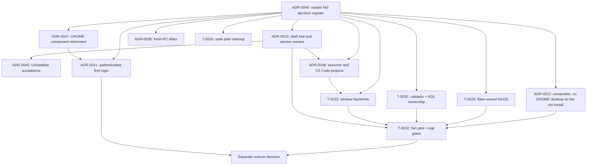

# ADR-0046: Niri desktop migration: central installation decisions, component owners and gaps
Status: partly-decided (central **inventory**, not an approval to install, select a shell or cut over) · Date: 2026-11-22 · Sources: ADR-0012/0013/0038/0041/0045; T-0029–T-0033; `docs/plans/niri-migration.md`, `docs/plans/niri-two-pc-pilot.md`, and the pilot Nix configuration.

## Laptop delivery by decision

**24 November 2026 · 50% (5/10) · high complexity.** [T-0032](../../work/active/T-0032-niri-trial-session/ticket.md) owns the ten delivery milestones, their evidence and execution order. The encrypted VM exercised offline setup at login, repeat execution and generation recovery. The physical Kingston boots both the base and NVIDIA variants. Physical generation recovery, a daily work session and independent data restoration are still open.

Each row counts the named completed and open checkpoints equally and rounds to the nearest whole percent. Percentages describe this deployment slice. Formal ADR decisions and wider platform work retain their own status. The ten end-to-end milestones are counted separately because several ADRs share the same tests. Complexity reflects the remaining coordination or failure impact: low for one local check, medium for several components, high for hardware, recovery, privacy or cross-service work.

| Decision and scope | Priority | Complexity | Complete | Evidence or completed checkpoints | Pending checkpoints |
| --- | --- | --- | --- | --- | --- |
| [ADR-0038](0038-disko-nixos-anywhere-fresh-hosts.md) Disk and installer | P0 | High | 75% (3/4) | Pinned Disko layout · Encrypted VM install · Physical Kingston cold boot | Record a complete destination storage/firmware review with the accepted kit |
| [ADR-0009](0009-two-machines-one-history.md) Deployment revision | P0 | Medium | 33% (1/3) | One repository identified | Freeze the clean deployment revision · Verify the offline checkout on the installed laptop |
| [ADR-0049](0049-niri-safest-staged-installation-order.md) Installation and recovery | P0 | High | 67% (4/6) | Locked system built · Blank-disk VM booted · Offline VM rescue passed · Physical install and cold boot | Bind final artifacts to destination hardware · Recover the known-good generation on the laptop |
| [ADR-0012](0012-desktop-compositor-gnome-niri-hyprland.md) Niri session | P0 | High | 75% (3/4) | Dedicated Niri system built · Authenticated guest session exercised · Physical input and both outputs reported | Verify suspend and output hotplug |
| [ADR-0041](0041-login-greeter-gdm-greetd-tuigreet-regreet.md) Greeter | P0 | Medium | 67% (2/3) | tuigreet launches the selected Niri package · Guest rejected a wrong password and returned to the greeter on logout | Repeat authentication and TTY recovery on the laptop |
| [ADR-0050](0050-nixos-niri-home-layout.md) Fresh home and handoff | P0 | Medium | 50% (2/4) | Integrated home declares work folders and SSH directory · Offline checkout and private reports exercised in fixtures | Seed the exact checkout and persist the log on the Kingston · Verify permissions and screenshot destination at first login |
| [ADR-0006](0006-ai-clis-claude-code-and-codex.md) Assistant CLIs | P1 | Low | 67% (2/3) | Both CLIs included on the ISO · Both started in the installed guest | Verify ordinary-user account access from the destination |
| [ADR-0047](0047-gnome-dependency-retirement-and-wayland-components.md) Desktop services | P1 | High | 50% (2/4) | GNOME desktop closure exclusions checked · Portal and Secret Service owners identified | Exercise chooser, screencast and keyring on the laptop · Check service ownership during shell trials |
| [ADR-0022](0022-browsers.md) Browser and handlers | P1 | Medium | 75% (3/4) | Brave in base profile · Firefox in optional bundle · Restored MIME associations preserved in fixtures | Check browser, PDF and link handlers after a second activation |
| [ADR-0026](0026-editors-and-ides.md) Editor and IDE | P1 | Medium | 50% (2/4) | VS Code in base profile · Android Studio in optional bundle | Open the intended workspace with multiple windows · Run a real project build and tests |
| [ADR-0027](0027-launcher-clipboard-windows-input-macos-ux.md) Launcher and clipboard | P1 | Medium | 50% (2/4) | Vicinae service exercised · Clipboard command invoked in guest | Launch a known application via search · Retrieve a known clipboard item |
| [ADR-0048](0048-niri-launcher-vscode-project-workflows.md) Project selection | P1 | High | 50% (2/4) | VS Code recents command registered · Extension deeplink invoked | Select the correct folder among open windows · Verify repeat focus under both keyboard layouts |
| [ADR-0025](0025-terminal-environment.md) Terminal | P1 | Low | 67% (2/3) | Ghostty packaged · Guest shortcut opened Ghostty | Verify terminal input and project commands on hardware |
| [ADR-0036](0036-screenshots-media-images-and-pdf.md) Screenshots and capture | P1 | High | 50% (2/4) | Durable screenshot destination configured · Flameshot and OBS staged | Save and reopen a laptop screenshot · Check sensitive-window exclusion and receiver-visible capture |
| [ADR-0023](0023-password-managers-and-secrets-cli.md) Vault access | P0 before data | High | 67% (2/3) | KeePassXC in base · Restored disposable vault opened | Open a representative restored vault from independent storage |
| [ADR-0033](0033-communication-sync-notes-and-backup.md) Backup and sync | P0 before data | High | 50% (2/4) | Kopia selected and packaged · Same-filesystem fixture restored | Restore from intended repository onto independent media · Verify owner access to recovered data |
| [ADR-0021](0021-cross-platform-parity-and-profiles.md) Profile parity | P1 | Medium | 50% (2/4) | Base and optional app sets separated · Optional bundle built | Enable the required apps in the integrated profile · Verify the resulting daily workflows |
| [ADR-0028](0028-files.md) Files and chooser | P1 | Medium | 50% (2/4) | GTK chooser selected · Double Commander and disk tools staged | Exercise graphical open and save · Test required file operations on the laptop |
| [ADR-0013](0013-desktop-shell-bar-notifications-trial.md) Desktop shell trial | P1 | High | 25% (1/4) | Trial order recorded | Run the ticket’s shell acceptance gates · Verify shell-stop recovery · Select a passing shell |
| [ADR-0045](0045-niri-windows-like-desktop-shell-ux.md) Desktop interaction | P1 | High | 25% (1/4) | Workflow criteria defined | Exercise window and task switching · Measure hotplug, lock and resume · Record a shell decision from the results |
| [ADR-0040](0040-macos-home-layout-and-cleanup-policy.md) Shared folder semantics | P2 macOS | Medium | 50% (2/4) | Shared naming and retention proposal documented · Niri handoff exercised on fixtures | Obtain macOS owner decision · Verify on a work Mac |

## Software installation order

Ranks are approximate deployment priorities. Ranks 1–4 ship together in the base system. Later ranks list the 15 applications already built in the separate workflow bundle and the steps needed to make selected clients usable. The order favours recovery, access and a real development session. The prepared candidate declares these lists in `nix/hosts/linux-niri/{system,home,workflow-apps}.nix`. Confirm the files exist at the selected deployment revision.

| Rank | Software | Delivery state | Acceptance on the laptop |
| ---: | --- | --- | --- |
| 1 | systemd-boot, LUKS2, NetworkManager, greetd/tuigreet, Niri | Base; Disko prepares the disk from installer media | Cold boot, unlock, authenticate, connect to Wi-Fi as the ordinary user, recover via TTY |
| 2 | Ghostty, Git, Claude Code, Codex, tmux, ripgrep, btop | Base with offline checkout recovery at login | Open a terminal, verify the checkout revision, sign in and obtain an assistant response |
| 3 | swaylock, swayidle, Soteria, PipeWire/WirePlumber, desktop portals, brightnessctl, playerctl | Base | Lock, suspend, resume, test sound, brightness and permission prompts |
| 4 | Brave, VS Code, Vicinae and its VS Code recents extension, KeePassXC, Kopia | Base | Launch the correct project, use the browser, open a restored vault and verify recovery |
| 5 | wl-clipboard, pavucontrol, Firefox, Bruno | Optional bundle | Verify clipboard retrieval, mic and speakers, required browser behavior and a project API request |
| 6 | Flameshot, OBS Studio, Double Commander, LocalSend | Optional bundle | Capture safely, check the receiver’s view, browse and transfer a test file |
| 7 | Obsidian, Syncthing, Telegram Desktop, Vesktop | Optional bundle; enrol accounts and sync explicitly | After restore and privacy checks, verify the vault, sync paths and required communications |
| 8 | QDirStat, Czkawka, Android Studio | Optional bundle | Enable storage tools or the mobile development stack when a real workflow needs them |
| Trial after baseline recovery | Dux, then Noctalia if needed | Shell candidates | Keep the first candidate that passes the mandatory shell and recovery checks |

The revised home also ships Fish, PHP/Composer, Node/pnpm, Python/uv and profile-selected Go. The login runner adds the three bootstrap-owned client tools from the store. For PHP/JS, prove one checkout's documented runtime setup, dependency installation and test command. The base editor and optional app bundle alone do not establish the development environment.

## Purpose and authority

See the [shared work-folder convention](0040-macos-home-layout-and-cleanup-policy.md#shared-work-folder-convention) for backup inclusion and [ADR-0050](0050-nixos-niri-home-layout.md) for the first-login screenshot and provisioning checks.

This is the **entry point for the Niri desktop migration**: one place to discover every required or desired install component, what was selected, what is merely proposed, which file owns it, why, how to validate it, and what remains undecided. It **does not replace** the rationale or acceptance criteria of the linked ADRs and tickets. If a component's owner ADR says `proposed` or `trial`, this inventory **cannot** silently promote it to `decided`.

**Selected first deployment.** Build `linux-niri` from one locked package set, with native Niri, greetd, integrated Home Manager and declarative Disko storage. The existing GNOME PC remains the working machine while the laptop is prepared. A fresh home must have an authenticated session, Ghostty, Vicinae and working console networking on first boot. The GNOME ScreenCast portal, GNOME Keyring and GTK file chooser support these workflows. [Installation and recovery gates](0049-niri-safest-staged-installation-order.md)

**Read statuses literally:**
- **Selected** = explicitly decided for the stated **phase**, not proof of installation.
- **Declared** = present in committed Nix/chezmoi configuration; **does not** prove installed on a physical machine.
- **VM-checked** = the existing pilot VM test exercised a narrow subset; **does not** prove GPU, outputs, suspend, apps or cutover.
- **Trial** = evaluation order approved, **not** a permanent component choice.
- **Proposed** = candidate only. **—** = **no permanent selection recorded**, deliberately blank; a gap entry below owns the decision.
- **Inherited** = currently packaged/configured for the Linux desktop profile, not a fresh Niri-specific selection.
- **Pending verification** = untested in the intended real desktop session.

Never equate "in `nixpkgs`", "documented upstream", "module enabled in PC 2 config", "built in QEMU", "installed on PC 2" and "selected for PC 1 cutover".

## Scope and sequencing

1. Prepare Claude Code access as an ordinary user on the installation workstation before disk work. Include the CLI in the target and keep authentication outside the deployment.
2. Build the exact Niri system with its dedicated user profile. The older `linux-desktop-pilot` tests GDM and GNOME with a second Niri session. Its results belong to that host.
3. Rehearse the complete deployment to a disposable UEFI disk. Boot through LUKS with an empty home, then exercise rollback and installer rescue.
4. Install from USB on the destination laptop or an isolated helper with the Kingston as the sole writable target. The attached-SSD route on the running daily PC awaits tested disk guards. Cold boot and repeat recovery on the destination. [Runbook](../../platforms/nixos/niri-install.md)
5. Verify the laptop, select the first shell candidate that passes the workflow and recovery checks, then trial daily use. Migrate personal data after an independent Kopia restore and daily acceptance.

### Decision hierarchy
- **Compositor/session:** [ADR-0012](0012-desktop-compositor-gnome-niri-hyprland.md); [T-0029](../../work/active/T-0029-nixos-system-ownership/ticket.md), [T-0032](../../work/active/T-0032-niri-trial-session/ticket.md).
- **Shell, status/taskbar, notifications, lock/idle:** [ADR-0013](0013-desktop-shell-bar-notifications-trial.md); feature criteria [ADR-0045](0045-niri-windows-like-desktop-shell-ux.md).
- **Login/greeter:** [ADR-0041](0041-login-greeter-gdm-greetd-tuigreet-regreet.md).
- **Fresh-PC installation/disk:** [ADR-0038](0038-disko-nixos-anywhere-fresh-hosts.md); [two-PC plan](../../plans/niri-two-pc-pilot.md).
- **Keyboard, apps and window actions:** [ADR-0027](0027-launcher-clipboard-windows-input-macos-ux.md); [T-0031](../../work/active/T-0031-compositor-neutral-window-actions/ticket.md).
- **Screenshot/files/backup:** [ADR-0036](0036-screenshots-media-images-and-pdf.md), [ADR-0028](0028-files.md), [ADR-0033](0033-communication-sync-notes-and-backup.md); [T-0032](../../work/active/T-0032-niri-trial-session/ticket.md).
- **Validation/document drift:** [T-0030](../../work/active/T-0030-validator-nixos-programs-and-niri/ticket.md), [T-0033](../../work/active/T-0033-refresh-stale-migration-docs/ticket.md).

## Installation decision matrix

**Columns:** section A records the selected fresh-host deployment. In sections B–D the pilot and inherited entries describe the historical GNOME reference configuration. The future column is a **permanent selection** only when explicitly supported by another ADR. **—** means deliberately undecided; it must remain empty until an owner decision. The status column identifies the corresponding decision or implementation stage, not deployment success. Links point to the owner decision/ticket or committed configuration.

### A. Foundation, installation and login

| Component | Selected for the first installed generation | Gate and owner |
|---|---|---|
| System and account | `nixosConfigurations.linux-niri`, normal user with interactive password and sudo, NetworkManager with console tools | G27, T-0029. Build the actual host and prove an authenticated cold login |
| Storage and boot | Disko, GPT, 1 GiB ESP, LUKS2/ext4, zram, hibernation disabled, systemd-boot, persistent `canTouchEfiVariables = false` | G01. Inspect destination hardware independently of disk mapping. [ADR-0038](0038-disko-nixos-anywhere-fresh-hosts.md) |
| User environment | Dedicated integrated Home Manager profile, system package set, HM ownership of Niri KDL and essential session declarations | G28, T-0030. Verify the initial deployment with an empty home and exactly one writer per path |
| Installer selection | Explicit Niri target. Keep application choices independent of per-account sync and gateway enrolment | G28, T-0042. Bypass legacy system setup and standalone activation for this host |
| Login and compositor | greetd + tuigreet → `niri-session`, NixOS `programs.niri`, matching Mesa, native on-demand `xwayland-satellite` | G02/G27. Validate installed KDL, authenticated login and logout. [ADR-0041](0041-login-greeter-gdm-greetd-tuigreet-regreet.md) |
| First-login tools | Claude Code, Ghostty, Vicinae, brightness/media commands, essential MIME defaults, home and screenshot directories | G28. Open the bound terminal and launcher from a fresh home. [ADR-0050](0050-nixos-niri-home-layout.md) |
| Session safety | Independent swaylock and swayidle, one Soteria polkit agent, GNOME Keyring with greetd PAM | G03/G17/G18/G21. Verify lock, suspend, authentication prompts and credential retrieval with dummy data |
| Portals and audio | GTK file chooser, GNOME ScreenCast, PipeWire and WirePlumber | G11/G12/G24. Exercise the interfaces in the actual applications. [ADR-0047](0047-gnome-dependency-retirement-and-wayland-components.md) |
| Recovery | Text console, optionally enrolled key-only SSH, known-good boot generation, installer rescue, separate Kopia restore | G13. Record the VM rehearsal and laptop results independently |

### B. Desktop interface, taskbar and interaction

| Component / required function | PC 2 pilot / current state | Permanent Niri target | State / why / reference |
|---|---|---|---|
| Complete desktop shell | **—** (no bar or shell activated) | **—** | **Trial order selected: Dux → Noctalia**; iNiR additional *proposed* trial; Waybar stack fallback. **P0 G04**, [ADR-0013](0013-desktop-shell-bar-notifications-trial.md), [ADR-0045](0045-niri-windows-like-desktop-shell-ux.md) |
| Bottom taskbar / running apps / pins | **—** | **—** | **P0 G04**, explicit window focus, per-window close, running indicator, grouping and multi-instance switching before visual polish. [ADR-0045](0045-niri-windows-like-desktop-shell-ux.md) |
| Dock position / auto-hide / icon groups | **—** | **—** | **P1 G04**; bottom preferred, any edge/Island acceptable if demonstrably better. [ADR-0045](0045-niri-windows-like-desktop-shell-ux.md) |
| Window hide/show, restore, close | Existing GNOME helpers only; Niri backend **not implemented** | **—** (Niri has no native minimise; scratchpad/parking must be tested) | **P0 G05**, MRU focus and semantics [T-0031](../../work/active/T-0031-compositor-neutral-window-actions/ticket.md), [ADR-0045](0045-niri-windows-like-desktop-shell-ux.md) |
| Window search, app launcher, keyboard command menu | **Vicinae** in Linux desktop HM profile; Niri KDL binds launcher | **—** (Vicinae incumbent; compare Walker, Albert, Ulauncher, Rofi and shell launchers) | **P1 G23** feature-first replacement; preserve VS Code recent project opening, exact window focus, scripts and clipboard. [ADR-0048](0048-niri-launcher-vscode-project-workflows.md), [Vicinae HM](../../../nix/modules/home/vicinae.nix), [T-0031](../../work/active/T-0031-compositor-neutral-window-actions/ticket.md) |
| Clipboard command tools | `wl-clipboard` inherited | `wl-clipboard` | **Inherited** from GNOME profile, no independent history UI. [GUI HM](../../../nix/modules/home/gui.nix) |
| Clipboard **history UI/provider** | Vicinae in the incumbent workflow | **Vicinae during the trial** | **P1 G06**. Verify one history provider when configuring the shell. [ADR-0013](0013-desktop-shell-bar-notifications-trial.md) |
| Notifications / history / Do Not Disturb | **—** | **—** | **P0 G03**; select exactly one DBus notification owner (Dux, Noctalia or SwayNC), test Telegram/Vesktop. [ADR-0013](0013-desktop-shell-bar-notifications-trial.md), [T-0032](../../work/active/T-0032-niri-trial-session/ticket.md) |
| System tray / app indicators | **—** (GNOME uses AppIndicator in existing session) | **—** | **P0 G03**; taskbar or shell must supply real tray, no GNOME-only extension dependency. [ADR-0013](0013-desktop-shell-bar-notifications-trial.md), [GUI HM](../../../nix/modules/home/gui.nix) |
| Lock screen / idle / suspend protection | Legacy KDL included an inactive example | **swaylock + swayidle** during the shell trial | **P0 G03/G21**. Test lock before sleep, wrong password, resume, monitor hotplug and a shell crash. [T-0032](../../work/active/T-0032-niri-trial-session/ticket.md) |
| Power menu / logout / shutdown / restart | GDM/desktop baseline only | **—** | **P1 G07**; confirm safe session actions in final shell and greeter. [ADR-0013](0013-desktop-shell-bar-notifications-trial.md), [ADR-0041](0041-login-greeter-gdm-greetd-tuigreet-regreet.md) |
| Network, Bluetooth, brightness, media controls / OSD | NetworkManager enabled PC 2; shell UI **—** | **—** | **P1 G07**; system service and desktop control surface are distinct. [pilot system](../../../nix/hosts/linux-desktop-pilot/system.nix), [ADR-0013](0013-desktop-shell-bar-notifications-trial.md) |
| Widgets, themes, wallpaper, icons/cursor, night light | **—** | **—** | **P2 G08**; evaluate after core window controls work; options exist in shell ecosystems, none selected. [ADR-0045](0045-niri-windows-like-desktop-shell-ux.md) |
| Plugin system, IPC and runtime updates | **—** | **—** | **P1 G09**; select deterministic/pinned and offline-capable update ownership after shell selection. [ADR-0045](0045-niri-windows-like-desktop-shell-ux.md) |

### C. Input, media, applications and hardware

| Component / required function | PC 2 pilot / current state | Permanent Niri target | State / why / reference |
|---|---|---|---|
| Keyboard languages / layout switching | **US + Russian**, `grp:win_space_toggle`, from KDL | Same | **Selected/committed**, physical bindings require human test. [KDL](../../../home/dot_config/niri/config.kdl), [T-0032](../../work/active/T-0032-niri-trial-session/ticket.md) |
| Global shortcuts and app toggles | Essential Niri KDL bindings; GNOME helper currently active | **—** pending Niri backend for MRU/app focus/resize and bilingual parity | **P0 G05**; do not duplicate GNOME-only DBus logic. [T-0031](../../work/active/T-0031-compositor-neutral-window-actions/ticket.md) |
| Multi-monitor layout / hybrid GPU / scaling | Operator verified NVIDIA KMS, Niri, internal and external outputs | Hotplug and mixed-DPI behaviour pending | **P0 G10**; hotplug, mixed DPI and AMD/NVIDIA (nouveau). [T-0032](../../work/active/T-0032-niri-trial-session/ticket.md), [desktop stability](../../platforms/nixos/desktop-stability.md) |
| Screenshots / region / pin | **Flameshot** inherited from GNOME; Niri alternative **—** | **—** until live multi-output screenshot reproduction | **P0 G11**; consider Niri native action or grim/slurp/satty only if necessary. [ADR-0036](0036-screenshots-media-images-and-pdf.md), [T-0032](../../work/active/T-0032-niri-trial-session/ticket.md) |
| Screen sharing, recording, portal selectors | XDG portals from Niri module; practical selection **—** | **—** until monitor/window share works after hotplug/suspend | **P0 G11**, including Vesktop/Brave and file dialog. [T-0032](../../work/active/T-0032-niri-trial-session/ticket.md) |
| File chooser | GNOME portal and Nautilus available (Niri module's `useNautilus` default; not explicitly pinned in pilot) | **GTK portal** on the GNOME-free install (`programs.niri.useNautilus = false`, so Nautilus is not installed); **—** as a permanent choice | **P1 G12**; test dialogs across desktop apps. [T-0032](../../work/active/T-0032-niri-trial-session/ticket.md) |
| File manager | Nautilus + **Double Commander** in existing Linux desktop environment | Double Commander available in the workflow bundle; default file manager remains open | **Inherited**, preference/mime decision open; **G12**. [ADR-0028](0028-files.md), [GUI HM](../../../nix/modules/home/gui.nix) |
| Sound and microphone | Retain existing audio stack (no Niri-specific replacement) | Same, add shell OSD **—** | **Inherited**, live checks P0; OSD is **G07**; [T-0032](../../work/active/T-0032-niri-trial-session/ticket.md) |
| Terminal, browser, editor | **Ghostty**, **Brave** (default), Firefox, VS Code from existing profile | Retain; Niri-specific app/window rules **—** | **Inherited**, no new app selection implied; window rules belong to **G05**. [ADR-0022](0022-browsers.md), [ADR-0025](0025-terminal-environment.md), [ADR-0026](0026-editors-and-ides.md) |
| Password manager and key storage | **KeePassXC** primary; GNOME keyring/Secret portal still part of integration | KeePassXC primary | **Existing selection**, browser integration/unlock must pass. [ADR-0023](0023-password-managers-and-secrets-cli.md), [T-0032](../../work/active/T-0032-niri-trial-session/ticket.md) |
| Other retained desktop apps | Bruno, Obsidian, QDirStat, Czkawka, Double Commander, LocalSend, Telegram/Vesktop per existing profile and selection | Prebuild the locked daily workflow bundle; select packages in integrated Home Manager after recovery | [Package manifest](../../../nix/hosts/linux-niri/workflow-apps.nix). [T-0042](../../work/active/T-0042-install-selection/ticket.md), [T-0032](../../work/active/T-0032-niri-trial-session/ticket.md) |
| Backup / previous generation / recovery | Mandatory backup procedure **specified, not recorded complete** | Separate, verified rollback before every live activation/cutover | **P0 G13**; NixOS generations are **not data backups**. [backup gate](../../plans/niri-migration.md), [T-0029](../../work/active/T-0029-nixos-system-ownership/ticket.md) |
| Test/validation tooling | Niri KDL and toplevel builds, authenticated session VM and encrypted UEFI install/recovery VM | Full physical Niri session, service/portal, app parity and rollback evidence | **Partly implemented; P0 G14**, [T-0030](../../work/active/T-0030-validator-nixos-programs-and-niri/ticket.md), [T-0032](../../work/active/T-0032-niri-trial-session/ticket.md) |

**No row with `—` constitutes permission to install a guessed default.** If a required item is provided by the finally chosen shell, record **that shell as its single owner** and remove standalone duplicates. A shell may provide several UIs but must not own overlapping background providers.

## Open gaps: priority and home for the next decision

Priority means **P0 = blocks physical installation or safe Niri adoption at the indicated gate; P1 = required for complete daily UX/maintenance; P2 = optional or post-cutover**. Existing ADRs should be **amended first** when the topic is already covered; create a new ADR only when a distinct architectural choice is necessary.

| Gap | Priority / gate | Undecided output (keep `—` above) | Owner and next action |
|---|---|---|---|
| **G01** Destination hardware, disk identity and boot recovery | **P0 / physical install** | Validate the selected Disko layout on a disposable disk and the destination | [ADR-0038](0038-disko-nixos-anywhere-fresh-hosts.md) |
| **G02** Session service graph | **P0 / baseline and shell trial** | Session units stop on logout. Verify on-demand X11 compatibility | [T-0032](../../work/active/T-0032-niri-trial-session/ticket.md) |
| **G03** Notifications/tray, polkit, lock and idle | **P0 / shell trial** | Keep Soteria, swaylock and swayidle. Trial the shell as one notification and tray provider | [ADR-0013](0013-desktop-shell-bar-notifications-trial.md) |
| **G04** Permanent shell, taskbar/dock, pinned/running app behaviour | **P0 / Niri as daily desktop** | — | [ADR-0013](0013-desktop-shell-bar-notifications-trial.md) trial choice, [ADR-0045](0045-niri-windows-like-desktop-shell-ux.md) weighted UX criteria; select on real evidence, then amend both |
| **G05** Niri window backend, MRU, hide/show, close, bilingual shortcuts | **P0 / parity sign-off** | — | [T-0031](../../work/active/T-0031-compositor-neutral-window-actions/ticket.md); Niri backend still missing. Distinguish native Niri capabilities from shell scratchpad workarounds |
| **G06** Clipboard history final provider and duplication policy | **P1 / shell selection** | — | [ADR-0013](0013-desktop-shell-bar-notifications-trial.md); Vicinae preferred; explicitly close the owner choice and reconcile the [two-PC plan](../../plans/niri-two-pc-pilot.md) |
| **G07** Power menu, quick settings, OSD, hardware controls | **P1 / daily desktop** | — | Evaluate chosen shell and system services in [T-0032](../../work/active/T-0032-niri-trial-session/ticket.md); create **new ADR only** if a significant standalone subsystem is chosen |
| **G08** Wallpaper/theme/cursor/widgets/night light | **P2 / polish** | — | [ADR-0045](0045-niri-windows-like-desktop-shell-ux.md); document only after P0, no ADR needed for trivial styling |
| **G09** Shell plugin packaging, updates and reproducibility | **P1 / permanent shell install** | — | [ADR-0045](0045-niri-windows-like-desktop-shell-ux.md) + [ADR-0021](0021-cross-platform-parity-and-profiles.md); a **new ADR may be warranted** if runtime Hub/store updates require exceptions to Nix ownership |
| **G10** Output profiles, GPU/scale/hotplug validation | **P0 / physical test & cutover** | — | [T-0032](../../work/active/T-0032-niri-trial-session/ticket.md); capture `niri msg outputs` on the target hardware, avoid inventing connector names or modes |
| **G11** Screenshots and screencast working path | **P0 / cutover** | — | [T-0032](../../work/active/T-0032-niri-trial-session/ticket.md), [ADR-0036](0036-screenshots-media-images-and-pdf.md); reproduce Flameshot multi-monitor portal failure before replacement |
| **G12** Niri file-manager/chooser preference | **P1 / application parity** | — | [ADR-0028](0028-files.md), [T-0032](../../work/active/T-0032-niri-trial-session/ticket.md); decide after checking Nautilus and Double Commander, not by assumption |
| **G13** Generation recovery and Kopia restore | **P0 / installation and personal data** | Retain a boot-tested distinct generation, rehearse mount-only rescue and restore representative data | [ADR-0049](0049-niri-safest-staged-installation-order.md) |
| **G14** Validator, end-to-end pilot and shell regression gates | **P0 / real shell trial and cutover** | — | [T-0030](../../work/active/T-0030-validator-nixos-programs-and-niri/ticket.md), [T-0032](../../work/active/T-0032-niri-trial-session/ticket.md); VM is insufficient for real GPU/portal verification |
| **G15** Graphical greeter comparison, and the greeter of the existing GNOME system | **P1** (the first greeter of the GNOME-free install, greetd + tuigreet, is P0 and belongs to **G27**) | — | [ADR-0041](0041-login-greeter-gdm-greetd-tuigreet-regreet.md) prefers **tuigreet** first; compares **ReGreet** (richer graphical) and **gtkgreet** (lean graphical), with GDM retained for current fallback |
| **G16** Historical plan drift and stale migration instructions | **P1 / before executing any stale guide** | — | [T-0033](../../work/active/T-0033-refresh-stale-migration-docs/ticket.md), particularly `docs/plans/migration/overview.md`, `docs/research/niri-vs-hyprland.md`, `docs/plans/hyprland-migration.md` |

### Scope of earlier choices

The older `linux-desktop-pilot` remains a reference for its own Niri/GDM smoke test and chezmoi KDL. On `linux-niri`, Home Manager owns the active KDL and the bootstrap must respect that ownership. Older in-place migration and separate Home Manager procedures apply to the GNOME reference setup only. A shell comparison or future provider change needs its own tests and decision. Refresh version-specific historical observations against the accepted installation revision.

## Addendum: explicit comparison and installation candidates (2026-11-22)

**Policy:** do not retain GNOME Shell or a GNOME desktop application simply for continuity, and **do not remove a GNOME portal/keyring simply because its name includes GNOME**. The actual winner must meet the required function, stability and security gates. This is a **candidate register**, not a manifest with automatic install permissions. See [ADR-0047](0047-gnome-dependency-retirement-and-wayland-components.md) for *pros/cons for every GNOME-related category*, [ADR-0048](0048-niri-launcher-vscode-project-workflows.md) for the launcher + VS Code project workflow, [ADR-0041](0041-login-greeter-gdm-greetd-tuigreet-regreet.md) for login.

### D. GNOME replacements and remaining desktop integrations

| Component / function | Existing or pilot implementation | Permanent Niri choice | Priority / candidate shortlist and rationale |
|---|---|---|---|
| **GNOME Shell / Mutter** | On the existing GNOME system and in the committed pilot; **not installed** on the GNOME-free niri install | **—** for retiring it on the existing system | **P0 G22** at GNOME fallback retirement, which comes after cutover; Niri owns window management; do not conflate GNOME desktop and required portal libraries. [ADR-0047](0047-gnome-dependency-retirement-and-wayland-components.md) |
| **GNOME ScreenCast portal** | `xdg-desktop-portal-gnome` from Niri module | **—** conditional exception | **P0: screen sharing must work**; **P1: replacing the working backend**. Compare [niri-screenshare](https://github.com/pantarune/niri-screenshare) first (Niri Dynamic Cast and config-mutation gate) and [xdg-desktop-portal-generic](https://github.com/lamco-admin/xdg-desktop-portal-generic) (ext/wlr protocols, unproven dynamic cast), without assuming parity. **G11/G18/G22**. |
| **GlobalShortcuts portal/settings** | Current route not end-to-end tested; upstream mentions `gnome-control-center` | **—** | **P1 G18**, **P0 if critical app requires it**; current GNOME component may remain standalone if needed; compare provider/consent and shortcut persistence. |
| **Secret portal / authentication** | GNOME Keyring and Soteria pilot, KeePassXC separate | **—** final Secret owner | **P0 for actual credential security; P1 replacement trial G18/G22**. Compare GNOME Keyring with **oo7-daemon + oo7-portal** under greetd, KeePassXC Secret Service and KWallet; use fake secrets on a machine with no real keyring (the pinned oo7 module is system-wide, so a test user isolates nothing), test PAM unlock and a single DBus owner. [ADR-0023](0023-password-managers-and-secrets-cli.md). |
| **GNOME Files as file browser** | Nautilus + Double Commander inherited | **—** | **P1 G12/G22**; feature-first compare **Dolphin**, standalone **Dux Files**, Double Commander, COSMIC Files, Thunar and Nautilus. Dux Files' portal is opt-in and **not fully modal**; chooser can be GTK portal separately. [ADR-0028](0028-files.md). |
| **FileChooser portal** | The legacy pilot inherits GNOME defaults | **GTK portal** | **P1 G12**. Test open/save in the browser and editor. Alternative pickers follow daily acceptance. |
| **Desktop login outside GNOME** | GDM in the committed pilot and on the existing system | **greetd + tuigreet** on the GNOME-free install (unverified on hardware) | **P0 G27** for that first greeter; **P1 G15** for the later comparison: prefer **greetd+tuigreet** for reliability; benchmark **ReGreet** (feature-rich graphical) and **gtkgreet** (lean graphical). GNOME fallback lock/PAM must work or remain safely on GDM. |
| **Launcher, clipboard, VS Code recent projects** | Vicinae with the upstream `vscode-recents` extension, plus the repo's `vscode-recent-projects` script on Vicinae's dmenu frontend | **—** | **P1 G23/G06**, conditional P0 if project opener is critical; **Vicinae vs Walker + Elephant** is the primary feature-rich comparison; Ulauncher, Albert, Rofi and shell remain contenders. Verify actual recent folder/workspace, correct Niri window MRU focus, clipboard and two-process startup. [ADR-0048](0048-niri-launcher-vscode-project-workflows.md). |
| **MIME / `xdg-open` / desktop links** | Current GNOME defaults inherited, not audited for Niri | **—** | **P1 G19**. Home Manager owns baseline associations on linux-niri. Audit desktop-specific handlers separately from mutable GNOME preferences. |
| **Accessibility / input method / compose** | US/RU XKB and existing keyd; no new IME chosen | **—** for optional IME | **P1 G20**; XKB/Compose vs Fcitx5/IBus only when actual input requirement exists. |
| **Power, suspend and lid policy** | The Niri host enables `power-profiles-daemon` and UPower. Laptop suspend, lid and wake remain hardware checks (G27) | **—** | **P0 G21** for a portable PC, otherwise P1; one policy owner among power-profiles-daemon/TLP/TuneD, and lock-before-suspend. |
| **USB mounts / audio / network / Bluetooth** | The Niri host declares NetworkManager, Bluetooth, udisks2, GVfs, PipeWire and rtkit (G27) | **—** for optional GUIs | **P1 G24**, P0 for required audio/Secret; inspect udisks2+GVfs, PipeWire+WirePlumber, BlueZ, shell controls; do not duplicate service owners. |
| **Nix update and retained recovery generations** | One system generation owns the Niri host and home | Boot-test and retain a known-good generation and copy the closure to independent storage | **P1 G25**; official `nixos-rebuild`, optional `nh` frontend, `nvd` diff; no second flake or uncontrolled GC. |
| **Screencast privacy and capture** | Niri/GNOME portal, Flameshot inherited | **—** | **P1 G26**, **P0 if secrets leak**; test native sensitive-window exclusion, native screenshots and optional Satty annotation before replacing applications. |
| **Wayland theme, UI utilities, night light** | GNOME defaults inherited, Niri shell not chosen | **—** | **P2 G08**; integrated shell preferred; compare swaybg, wlsunset, gtk/qt config, Stylix only if a feature gap is proven. |

### New uncovered gaps (G17–G28)

These extend **G01–G16** without deleting or renumbering previous dependencies. Do not create a one-package ADR when an existing owner suffices.

| Gap | Priority / gate | Unselected decision / required evidence | Existing owner |
|---|---|---|---|
| **G17 Emergency session recovery** | **P0 / shell activation** | TTY recovery from dead locker, shell crash, display failure, broken keybind and inaccessible portal; remote/previous-generation fallback works | [T-0032](../../work/active/T-0032-niri-trial-session/ticket.md) |
| **G18 Portal GlobalShortcuts + Secret + session routing** | **P1; P0 if required functionality fails** | Verify portal owner/interface, `gnome-control-center` necessity, auth/consent, Secret unlock, clipboard and screencast routing. Compare GNOME only against functional replacements | [T-0032](../../work/active/T-0032-niri-trial-session/ticket.md), [ADR-0047](0047-gnome-dependency-retirement-and-wayland-components.md) |
| **G19 MIME/URIs/desktop activation** | **P1** | HTTPS, mailto, VS Code URI, PDFs, folder handlers, `xdg-open` and portal activation from Niri | [ADR-0027](0027-launcher-clipboard-windows-input-macos-ux.md), [T-0032](../../work/active/T-0032-niri-trial-session/ticket.md) |
| **G20 Input methods and accessibility** | **P1** | US/RU, Compose/Unicode, keyboard navigation, input accessibility and application text input; extra IME only if needed | [T-0032](../../work/active/T-0032-niri-trial-session/ticket.md) |
| **G21 Power and suspend security** | **P0**: the new install is on a laptop (P1 on a stationary desktop) | Correct lid/power behaviour, lock-before-suspend order, resume authentication and no competing power controllers | [T-0032](../../work/active/T-0032-niri-trial-session/ticket.md), [ADR-0047](0047-gnome-dependency-retirement-and-wayland-components.md) |
| **G22 GNOME feature-by-feature retirement** | **P0 / GNOME removal; P1 pilot** | Enumerate GNOME Shell/apps/extensions and portal/keyring/control-center **separately**; keep only necessary or demonstrably superior functions | [ADR-0047](0047-gnome-dependency-retirement-and-wayland-components.md), [T-0033](../../work/active/T-0033-refresh-stale-migration-docs/ticket.md) |
| **G23 Rich launcher and VS Code project parity** | **P1 / launcher selection; P0 if required recent-project workflow breaks** | Vicinae vs Walker/Albert/Ulauncher/Rofi/shell; open actual VS Code folder or workspace, focus correct existing project window, scripts/clipboard/history | [ADR-0048](0048-niri-launcher-vscode-project-workflows.md), [T-0031](../../work/active/T-0031-compositor-neutral-window-actions/ticket.md) |
| **G24 Core service, removable device and mixer integration** | **P1; P0 for essential audio/mic** | PipeWire/WirePlumber, NetworkManager/BlueZ, udisks2/GVfs, UPower, detailed microphone/audio routing and safe USB eject | [T-0032](../../work/active/T-0032-niri-trial-session/ticket.md), [ADR-0028](0028-files.md) |
| **G25 Nix update/generation retention** | **P1 / PC 1 ownership** | `flake.lock`, `nixos-rebuild`, GC protection, live rollback, compare `nh`/nvd for usability without a second writer | [T-0029](../../work/active/T-0029-nixos-system-ownership/ticket.md), [ADR-0021](0021-cross-platform-parity-and-profiles.md) |
| **G26 Capture privacy and alternatives** | **P1; P0 if sensitive-window exposure** | Niri native capture vs Flameshot/Satty annotation, privacy/screencast exclusion rule and dual-monitor sharing; one hotkey flow | [ADR-0036](0036-screenshots-media-images-and-pdf.md), [T-0032](../../work/active/T-0032-niri-trial-session/ticket.md) |
| **G27 Niri-only host, `linux-niri`** | **P0 / acceptance A–B** | Build the exact system and verify the Niri session, dedicated profile, forbidden-component closure and a blank-disk UEFI login | [T-0029](../../work/active/T-0029-nixos-system-ownership/ticket.md), [T-0032](../../work/active/T-0032-niri-trial-session/ticket.md) |
| **G28 Dedicated user environment and installer selection** | **P0 / first installed generation** | Prove that an empty home has the KDL, terminal, launcher and command dependencies. Keep desktop, apps and account enrolments separate. Exercise the build-only installer selector and verify that a marked installation rejects legacy bootstrap | [T-0042](../../work/active/T-0042-install-selection/ticket.md), [T-0032](../../work/active/T-0032-niri-trial-session/ticket.md) |

**New comparison acceptance:** No permanent row is filled from this addendum alone. Record source, pinned version, verified feature, extra daemons and GNOME runtime closure in the **owning ADR** first, then change this matrix. A feature-rich complete shell should *replace* extra daemons, not collect duplicates.

### P0/P1 gate correction for the replacement-first audit

**Replacing a working GNOME component is not automatically P0.** A required capability (**working ScreenCast, secure Secret unlock, reliable FileChooser/login**) is P0 at its relevant cutover gate. A **GNOME-free replacement experiment** is P1 when a functional GNOME-named standalone service can safely remain without GNOME Shell. It escalates to P0 **only if** a stated architectural requirement mandates removal before cutover, or the incumbent fails functionality/security.

| Evaluation | Candidate order | Deployment safety / no-hidden-mutation gate |
|---|---|---|
| Niri ScreenCast backend G11/G18 | **Existing GNOME portal** baseline → [xdg-desktop-portal-generic](https://github.com/lamco-admin/xdg-desktop-portal-generic) (in the pinned nixpkgs, so runnable first) → [niri-screenshare](https://github.com/pantarune/niri-screenshare) (the Niri-specific candidate, once it has a reproducible package) | Niri Dynamic Cast, simultaneous streams, consent, Niri socket, monitor hotplug; forbid startup from writing `~/.config/xdg-desktop-portal/portals.conf` without an explicitly delegated declarative owner |
| Secret service G18/G22 | GNOME Keyring baseline → **oo7-daemon + oo7-portal** → KeePassXC Secret Service / KWallet | Test fake secrets on a machine with no real keyring, greetd PAM, exactly one `org.freedesktop.secrets` owner (enabling oo7 alone leaves gnome-keyring on), portal/daemon independence and rollback |
| Rich launcher G23 | Vicinae baseline ↔ **Walker + Elephant** → Ulauncher / Albert / Rofi / shell | Compare clipboard/Windows/Niri providers, exact VS Code workspace history and existing-window focus, both processes' overhead |
| Graphical greeter G15 | **tuigreet** TTY baseline; **ReGreet** richer GTK option; **gtkgreet** lean GTK option | On the GNOME-free install tuigreet is the first greeter; GDM remains on the existing GNOME system until its fallback/lock and TTY recovery are settled; ReGreet's NixOS module and startup support should count |
| Primary files + chooser G12 | **Dolphin** (mature full features) ↔ **Dux Files** (standalone, Nix portal) ↔ Double Commander (power-user); GTK chooser baseline | File operations and network shares; Dux Files chooser may ignore modal parent/uses portal preference files, must not replace defaults silently |

**Scope conservation:** these are **revisions to G11/G12/G15/G18/G22/G23**, not new gap numbers or new background-service requirements. Keep Kopia as the existing ADR-0033 backup choice until actual restore evidence identifies a deficiency.

## Migration dependency map

**Gate order:** Claude setup → host, integrated profile and Disko build → disposable UEFI install and recovery → destination cold boot and recovery → shell and daily workflows → verified personal-data restore and migration. [ADR-0049](0049-niri-safest-staged-installation-order.md)

## Maintenance of this register (acceptance criteria)

- [ ] Every **declared** component links to its real source file or owning ticket; every **selected/proposed** component links to an ADR with compatible status.
- [ ] All unselected permanent components show **—**, a gap ID and P0/P1/P2 priority. No unverified fact is labelled installed or tested.
- [ ] When a gap is resolved, change its owner ADR/ticket **first**, then this matrix and any stale cross-references **in the same change**. Avoid a separate ADR when a narrow amendment suffices.
- [ ] `tests/bash/adr-contract.bats`, link validation, relevant Nix evaluation and `bash ops/validate-config.sh` pass. This documentation update alone does not claim these runtime/build tests have run.
- [ ] No bootloader, disk, greeter, desktop services, live host or permanent session is changed by this ADR. A separate human-approved implementation and recovery gate remains mandatory.
