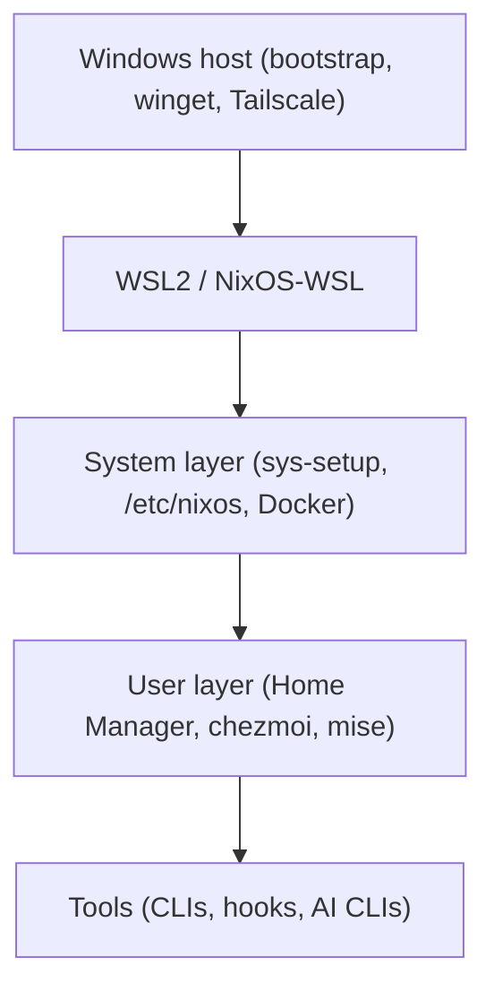

# Architecture decision records

Scope: [project scope](../project-scope.md) (ADR-0019). Short records of what was chosen, what lost and why. Statuses: decided, trial, proposed, open. "Not yet verified" means decided but not yet exercised on a real machine. Most WSL items come from T-0047.

| ID | Decision in one line | Status | Date |
|----|----------------------|--------|------|
| [0001](0001-wsl2-base-nixos-wsl.md) | WSL2 runs NixOS-WSL on the desktop path (sys-setup + standalone Home Manager) | decided, not yet verified | 2026-11-15 |
| [0002](0002-windows-provisioning-bootstrap-winget.md) | One PowerShell bootstrap; winget is the only Windows package manager | decided, not yet committed | 2026-11-15 |
| [0003](0003-docker-on-wsl-one-engine-in-nixos.md) | One declarative Docker engine inside NixOS-WSL; no automatic docker group | decided, not yet verified | 2026-11-15 |
| [0004](0004-tailscale-on-windows-only.md) | Tailscale on the Windows host only | decided, not yet verified | 2026-11-15 |
| [0005](0005-commit-tooling-first-hooks-everywhere.md) | lefthook, gitleaks and chezmoi before the first commit, hooks never bypassed | decided, Windows part planned | 2026-11-15 |
| [0006](0006-ai-clis-claude-code-and-codex.md) | Keep Claude Code and Codex; install only when missing; Claude runs in WSL | decided, installer not built | 2026-11-15 |
| [0007](0007-safety-net-restore-points-and-pinned-downloads.md) | Restore point, exports, pinned image, three distinct recoveries | decided, restore point observed 2026-11-15 | 2026-11-15 |
| [0008](0008-git-editor-per-host-profile.md) | Git editor nvim on wsl and linux-cli, `code --wait` elsewhere | decided, not implemented | 2026-11-15 |
| [0009](0009-two-machines-one-history.md) | Desktop first, sync by push/pull fast-forward only, split file ownership | decided | 2026-11-15 |
| [0010](0010-cross-os-settings-inventory-first.md) | Cross-OS settings: inventory, compare, baseline; apply nothing yet | decided, phase 1 done | 2026-11-15 |
| [0011](0011-windows-edition-and-apps.md) | Windows Home is enough; apps are a manual list; automation open | partly decided, automation open | 2026-11-14 |
| [0012](0012-desktop-compositor-gnome-niri-hyprland.md) | GNOME live; niri proposed trial; Hyprland parked | decided (GNOME), proposed (niri) | 2026-11-15 |
| [0013](0013-desktop-shell-bar-notifications-trial.md) | Trial Dux first, Noctalia second; no shell selected | trial | 2026-11-15 |
| [0014](0014-tool-stack-recap.md) | chezmoi, mise, Nix + Home Manager, nix-darwin + casks, lefthook | decided (recap) | not recorded |
| [0016](0016-native-windows-claude-status-line.md) | Native Windows Claude status line: repo script via Git Bash, opt-in bootstrap step `-ClaudeStatusLine` | proposed | 2026-11-15 |
| [0018](0018-interactive-config-manager-frontend.md) | Interactive configuration manager: a frontend over the existing selection (compiled wizard, Bash fallback); no installer of its own | proposed | 2026-11-16 |
| [0019](0019-platform-scope-linux-macos-wsl2-first.md) | Platform scope: Linux, macOS and WSL2 first; Windows stays a bounded bootstrap | decided | 2026-11-16 |

## Layers

The NixOS desktop uses the same system, user and tools layers without the two top boxes.

## Legacy records

`repo-docs/migration-decisions.md` (2026-05) is the earlier record. Its "primary host: wsl" row is stale.
