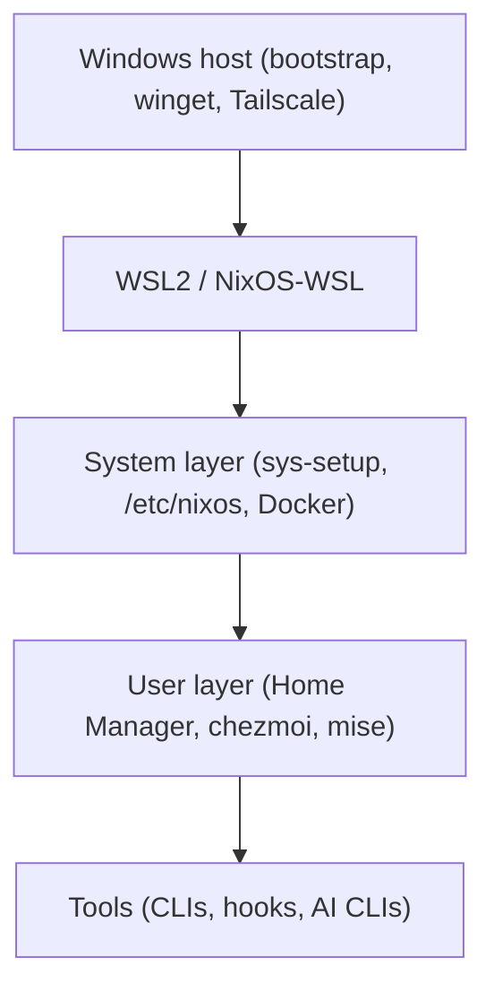

# Architecture decision records

Scope: [project scope](../project-scope.md) (ADR-0019). Short records of what was chosen, what lost and why. Most WSL items come from T-0047.

## Before writing a new ADR

1. Search the frontmatter for overlap: `grep -l "windows" docs/architecture/decisions/0*.md`, or grep the `platforms:`, `permits:` and `forbids:` lines for your keywords.
2. Read every related ADR found, and check whether yours amends or supersedes one.
3. Add frontmatter (below) and an index row with the same status. `tests/bash/adr-contract.bats` checks the required fields and the row.
4. An ADR numbered above 19 with the `windows` platform must cite ADR-0019 in `amends` or `related`, and needs an explicit owner decision. Earlier ADRs are not retro-required to cite ADR-0019 unless it amends them.

## Frontmatter

Every ADR starts with a YAML block. Keep the human "Status: ... · Date: ..." line under the title. The tags were chosen by hand from reading each ADR; no automated keyword analysis was used.

| Key | Required | Meaning |
|-----|:--------:|---------|
| `adr` | yes | Integer equal to the filename number |
| `status` | yes | One of the values below; a `superseded` ADR also needs `superseded_by` |
| `platforms` | yes | Closed set: `linux`, `nixos`, `macos`, `wsl`, `windows`, `cross` |
| `amends`, `supersedes`, `superseded_by` | yes (may be `[]`) | Lists of ADR numbers (no leading zeros); each must exist |
| `title`, `date` | no | Short title; `YYYY-MM-DD` or `unknown` |
| `areas` | no | Short open list of topics (for example `docker`, `hooks`, `desktop`) |
| `permits` | no | Keywords for what the ADR allows |
| `forbids` | no | Keywords for what the ADR rules out (ruled out, not merely deferred) |
| `related` | no | Ticket ids or related ADR numbers (e.g. T-0047, 19) |

Statuses (the index row repeats the value exactly; details stay in the ADR's own Status line):

| Status | Meaning |
|--------|---------|
| `decided` | Chosen and, where it has code, built |
| `decided-unverified` | Chosen; not yet built or exercised on a real machine |
| `partly-decided` | Some points chosen, others open |
| `proposed` | Awaiting an owner decision |
| `trial` | Being tried; nothing selected |
| `superseded` | Replaced; see `superseded_by` |
| `rejected` | Considered and refused |

`platforms: [cross]` means all targets. `windows` means the ADR adds or changes something on the Windows host, and is bounded by ADR-0019.

| ID | Decision in one line | Status | Date |
|----|----------------------|--------|------|
| [0001](0001-wsl2-base-nixos-wsl.md) | WSL2 runs NixOS-WSL on the desktop path (sys-setup + standalone Home Manager) | decided-unverified | 2026-11-15 |
| [0002](0002-windows-provisioning-bootstrap-winget.md) | One PowerShell bootstrap (committed); winget is the only Windows package manager | decided | 2026-11-15 |
| [0003](0003-docker-on-wsl-one-engine-in-nixos.md) | One declarative Docker engine inside NixOS-WSL; no automatic docker group | decided-unverified | 2026-11-15 |
| [0004](0004-tailscale-on-windows-only.md) | Tailscale on the Windows host only | decided-unverified | 2026-11-15 |
| [0005](0005-commit-tooling-first-hooks-everywhere.md) | lefthook, gitleaks and chezmoi before the first commit, hooks never bypassed | decided | 2026-11-15 |
| [0006](0006-ai-clis-claude-code-and-codex.md) | Keep Claude Code and Codex; install only when missing; Claude runs in WSL | decided-unverified | 2026-11-15 |
| [0007](0007-safety-net-restore-points-and-pinned-downloads.md) | Restore point, exports, pinned image, three distinct recoveries | decided | 2026-11-15 |
| [0008](0008-git-editor-per-host-profile.md) | Git editor nvim on wsl and linux-cli, `code --wait` elsewhere | decided-unverified | 2026-11-15 |
| [0009](0009-two-machines-one-history.md) | Desktop first, sync by push/pull fast-forward only, split file ownership | decided | 2026-11-15 |
| [0010](0010-cross-os-settings-inventory-first.md) | Cross-OS settings: inventory, compare, baseline; Windows apply only via ADR-0020/0034/0035 | decided | 2026-11-15 |
| [0011](0011-windows-edition-and-apps.md) | Windows Home is enough; apps are a manual list; automation open | partly-decided | 2026-11-14 |
| [0012](0012-desktop-compositor-gnome-niri-hyprland.md) | GNOME live; niri proposed trial; Hyprland parked | partly-decided | 2026-11-15 |
| [0013](0013-desktop-shell-bar-notifications-trial.md) | Trial Dux first, Noctalia second; no shell selected | trial | 2026-11-15 |
| [0014](0014-tool-stack-recap.md) | chezmoi, mise, Nix + Home Manager, nix-darwin + casks, lefthook | decided | not recorded |
| [0015](0015-wsl-distro-selection-nixos-or-ubuntu.md) | WSL distro: NixOS-WSL by default, Ubuntu supported; one `wsl` profile | decided-unverified | 2026-11-15 |
| [0016](0016-native-windows-claude-status-line.md) | Native Windows Claude status line: repo script via Git Bash, opt-in bootstrap step `-ClaudeStatusLine` | decided-unverified | 2026-11-15 |
| [0017](0017-interactive-shell-fish-or-zsh.md) | fish primary interactive shell for testing purposes; zsh stays supported | trial | 2026-11-16 |
| [0018](0018-interactive-config-manager-frontend.md) | Interactive configuration manager: a frontend over the existing selection (compiled wizard, Bash fallback); no installer of its own | proposed | 2026-11-16 |
| [0019](0019-platform-scope-linux-macos-wsl2-first.md) | Platform scope: Linux, macOS and WSL2 first; Windows stays a bounded bootstrap | decided | 2026-11-16 |
| [0020](0020-windows-safe-settings-snapshot-first.md) | Windows safe settings: committed settings snapshot first, opt-in step W (HKCU, current-user Appx), profile selector, rollback | decided-unverified | 2026-11-16 |
| [0021](0021-cross-platform-parity-and-profiles.md) | Cross-platform parity (Linux and macOS first, Windows follows winget), the R1 native exception, host profiles, one owner per binary | partly-decided | 2026-11-16 |
| [0022](0022-browsers.md) | Browsers: Brave stable everywhere, Firefox secondary | partly-decided | 2026-11-16 |
| [0023](0023-password-managers-and-secrets-cli.md) | Password managers: KeePassXC primary, Bitwarden allowed, op for dev secrets | partly-decided | 2026-11-16 |
| [0024](0024-database-clients.md) | Database clients: Beekeeper Studio everywhere, DBeaver on macOS, HeidiSQL on Windows | partly-decided | 2026-11-16 |
| [0025](0025-terminal-environment.md) | Terminal environment: terminal, multiplexer, prompt, font, PowerShell | proposed | 2026-11-16 |
| [0026](0026-editors-and-ides.md) | Editors and IDEs: VS Code, Neovim, Android Studio on Linux | proposed | 2026-11-16 |
| [0027](0027-launcher-clipboard-windows-input-macos-ux.md) | Launcher, clipboard, window management, input and macOS UX: Raycast on Windows, PowerToys | partly-decided | 2026-11-16 |
| [0028](0028-files.md) | Files: file managers, disk usage (GrandPerspective, WizTree exceptions), duplicates, archives | partly-decided | 2026-11-16 |
| [0029](0029-networking-and-remote-access.md) | Networking: no Tailscale on work hosts, OpenSSH, WinSCP | partly-decided | 2026-11-16 |
| [0030](0030-containers-and-local-services.md) | Containers: one CLI owner, engine per host, Docker Desktop discarded | proposed | 2026-11-16 |
| [0031](0031-dev-runtimes-git-clients-api-client.md) | Dev runtimes, Git clients and API client | proposed | 2026-11-16 |
| [0032](0032-ai-clis-context-tools-and-desktop-apps.md) | AI CLIs, context tools and desktop apps; packers removed after audit | partly-decided | 2026-11-16 |
| [0033](0033-communication-sync-notes-and-backup.md) | Communication, sync, notes and backup: Kopia plus Time Machine | partly-decided | 2026-11-16 |
| [0034](0034-nvidia-3d-settings-as-code.md) | NVIDIA global 3D settings as code (personal profile, NVIDIA hardware only): captured Profile Inspector profile, snapshot first | decided-unverified | 2026-11-16 |
| [0035](0035-windows-telemetry-reduction.md) | Telemetry reduction for the personal setup profile; the work profile touches no telemetry | decided-unverified | 2026-11-16 |
| [0036](0036-screenshots-media-images-and-pdf.md) | Screenshots, media, images and PDF: Flameshot, Preview, Edge PDF, IINA, Paint.NET | partly-decided | 2026-11-16 |
| [0037](0037-system-monitoring-diagnostics-device-software.md) | System monitoring, diagnostics and device software | proposed | 2026-11-16 |
| [0038](0038-disko-nixos-anywhere-fresh-hosts.md) | disko and nixos-anywhere install fresh NixOS hosts only (VM test first, by-id disks, never the live desktop) | proposed | 2026-11-20 |
| [0039](0039-windows-work-password-manager.md) | Windows work profile: KeePassXC, Bitwarden allowed, installed by hand with winget; employer policy wins | decided-unverified | 2026-11-20 |

The tool-selection ADRs 0021 to 0033, 0036 and 0037 are written (ADR-0021 holds parity and profiles); gaps are allowed by the contract.

## Layers

The NixOS desktop uses the same system, user and tools layers without the two top boxes.

## Legacy records

`repo-docs/migration-decisions.md` (2026-05) is the earlier record. Its "primary host: wsl" row is stale.
