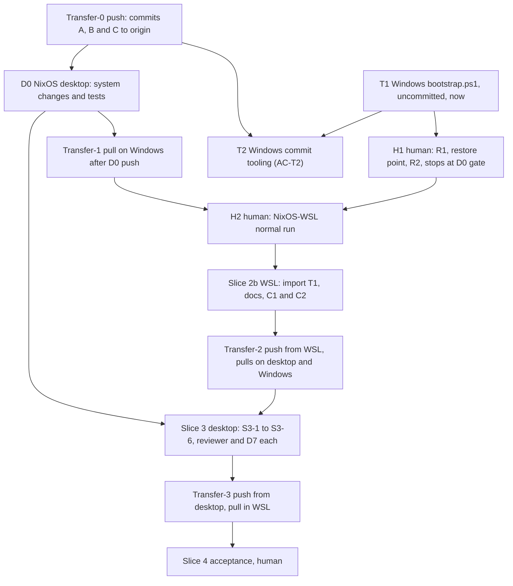

# T-0047 NixOS-WSL, desktop-first: execution plan

- **Status:** draft
- **Work id:** T-0047-nixos-wsl (`Source: local`, per ticket.md)
- **Branch:** main (work branch: unknown)
- **Designed against:** `c644dd6` (main)
- **Transfer-0 commits (A, B, C):** unknown until pushed (Windows, docs only)
- **Date:** 2026-11-15

## Context

- WSL2 on this Windows 11 PC must be reproducible and at parity with the NixOS desktop (CLI/dev).
- Milestone 1 only. Milestone 2 is listed under Notes and is out of scope.
- Ticket: `docs/work/active/T-0047-nixos-wsl/ticket.md`. Supersedes T-0034 and T-0039. T-0040 acceptance = Slice 4.
- Nothing depends on Windows Pro.

## Decision

Chosen (user, recorded):

- Base: NixOS-WSL, desktop path. Stock `/etc/nixos` (outside repo) + `ops/system-setup.sh` (sys-setup) + `nixos-rebuild`. Standalone Home Manager `wsl` profile + chezmoi + mise via shared `ops/install.sh`.
- No `nixosConfigurations` in the flake (later milestone, T-0029; see Decisions).
- Reuse NixOS modules and scripts; no WSL copies. `genericLinux` stays for non-NixOS Linux, removed only from `nix/hosts/wsl/home.nix`.
- WSL user `utmostcreator`. The old `nixos` user may stay; acceptance does not check it.
- Windows provisioning by ops/windows/bootstrap.ps1 (runs wsl.exe). winget stays manual (T-0041).
- Tailscale: Windows only. `ENABLE_TAILSCALE=0` on wsl.
- Docker: declarative via `nix/modules/nixos/docker.nix` through sys-setup. Off by default on wsl. `myConfig.docker.user = null` unless `DOCKER_GROUP=1` (rootful). `DOCKER_ROOTLESS=1` measured in acceptance, fallback rootful + group. Refused when Docker Desktop integration is present.
- AI CLIs: ops/ai-cli-install.sh (S3-5). Codex stays: OpenAI's CLI, and ai-cli-updates.nix already runs its update timers. The research suggestion to drop it is rejected.
- Git editor: nvim on wsl/linux-cli; `code --wait` on macos/linux-desktop.
- Transfer: commit and push to origin (user decision 2026-11-15; replaces git bundle). `git pull --ff-only` before work and before each commit; push right after each commit; no force-push, rebase or stash. Commits only where hooks run. Exception: Transfer-0 (docs only, Windows, pre-commit run by hand) until AC-T2 passes. Each session confirms its own push authorisation for its task (AGENTS.md).
- Restore points: Windows restore point before `wsl --install`; `wsl --export` before setup and before Docker (`-Export before-docker`); no export after install (text before/after reports instead). Exports after Docker or after install stay rejected (size, secrets).

Rejected alternatives: Ubuntu, apt, wsl.conf writer, `wsl-docker.sh`; `nixosConfigurations` now; Tailscale inside WSL; automatic docker group; automated winget; export after install.

Reboot points:

- R1: edition upgrade or pending update. The bootstrap refuses while CBS RebootPending is set.
- R2: after `wsl --install --no-distribution`.
- Everything else is a WSL restart, not a Windows reboot.

## Order

## Acceptance criteria

- [ ] **AC-B1** `wsl.defaultUser = lib.mkForce "utmostcreator";` in a WSL-only module. Build passes. WSL launches as utmostcreator. A test proves a stock `"nixos"` value loses.
- [ ] **AC-B2** sys-setup backs up every /etc/nixos file it may touch and restores the exact state on a validation (dry-build) failure (content, mode, owner, symlink, existence). Tested for success and simulated failure (D2b). The desktop is unchanged after a validation failure. On a switch failure it prints the `nixos-rebuild switch --rollback` command.
- [ ] **AC-T1** Bootstrap tests pass, ParseFile, ASCII. While RebootPending is set, the real dry run stops at step 0 without writing. After R2 a normal run checks the WSL version, imports NixOS, runs nix-channel and the systemd/interop check, then stops at the D0 gate (step 6, exit 3). The before-setup report and export run in H2.
- [ ] **AC-D** D1 to D6 and D8 pass on the real desktop, with evidence. D7 is checked per S3 task, not here.
- [ ] **AC-WSL** Measured in Slice 4:
  - sys-install, sys-update, `nix flake check`
  - Docker (when enabled)
  - Claude and Codex, update services, a subagent spawn
  - statusline
  - a WSL restart keeps the user, systemd and interop
  - origin not under /mnt; ~/Projects on ext4
  - tailnet reachable from WSL via Windows Tailscale
  - timezone; substituters
- [ ] **AC-NEG** macOS, linux-desktop and linux-cli unchanged (full bats, flake check, builds). Pushes only in the Transfer steps (user-authorised 2026-11-15; each session confirms its own push authorisation, AGENTS.md). No `wsl --unregister` scripted.
- [ ] **AC-TZ** Timezone decided in Slice 4: sys-setup forces Europe/London (mkForce); compare with Windows and record the decision.
- [ ] **AC-DOCKER-MSG** The ops/projects/workspace/config.sh:88-89 error text is fixed in Slice 2b (points to the sys-setup Docker path, not Docker Desktop's WSL integration).
- [ ] **AC-T2** The T2 stub tests pass. On the real Windows clone, `ops/doctor.sh` and `ops/validate-config.sh` exit 0, the hooks are installed, the commit-msg good and bad cases behave, and gitleaks catches a planted token. Once AC-T2 passes, Windows commits are allowed (including T1 and T2).

## Tasks

- [ ] **Transfer-0** Push/pull: commits A, B and C on Windows, pushed to origin (first step; the one hooks exception)
  - Files: commit A: `docs/work/active/T-0048-cross-os-settings/` (Windows session). Commit B (6 files): `docs/work/active/T-0047-nixos-wsl/ticket.md`, `docs/work/active/T-0047-nixos-wsl/plan.md`, `docs/work/index.md`, `docs/platforms/wsl/setup.md`, `docs/platforms/wsl/windows-and-wsl.md`, `docs/platforms/windows/setup.md`. Commit C (4 files): docs/platforms/index.md, docs/platforms/base.md, `README.md`, `docs/index.md`. Docs only; T1 files stay untracked.
  - Steps: in order A, B, C. Each: `git pull --ff-only`; stage that commit's files only (T1 files stay out); run `bash ops/hooks/pre-commit.sh`; commit; `git push origin main` right after. Subjects: A `docs(settings): T-0048 Windows settings inventory`; B `docs(wsl): plan T-0047 NixOS-WSL desktop-first`; C `docs(setup): add the setup index and base requirements`. Windows tools: winget ids `twpayne.chezmoi` and `Gitleaks.Gitleaks`, each checked with `command -v`. The pre-commit hook must pass with a working gitleaks scan; a failing hook is never bypassed. The NixOS desktop then runs `git pull --ff-only`.
  - Depends: none. Covers: AC-NEG. Risk: low. Review: yes, a reviewer pass before the commit.
  - Verify: Windows results (the real pre-commit hook, gitleaks scan) recorded here. Linux results, after the `git pull --ff-only` on the NixOS desktop: `bats tests/bash/path-contract.bats` and `bats tests/bash/doc-contracts.bats`, recorded separately under evidence/. Per commit, `git show --stat` lists only that commit's paths.
  - Done: commits A, B and C on origin `main`; their SHAs recorded here; the NixOS pull is ff-only.

- [ ] **T1** Windows bootstrap, uncommitted, now
  - Files: ops/windows/bootstrap.ps1, tests/windows/bootstrap.tests.ps1 (PS 5.1, ASCII; `-DryRun`, `-EnableSystemRestore`, `-Export`, `-Report`; exit 0/1/2/3).
  - Steps: 0 reboot-pending and before report; 1 restore point + `wsl --install --no-distribution` (elevated) then R2; 2 WSL >= 2.4.4; 3 pinned NixOS-WSL tag with committed SHA256 (a matching cached download is reused), `wsl --import NixOS`; 4 nix-channel; 5 systemd + interop; 6 D0 gate: `wsl.nix` present, checked before the clone. An existing clone lacking `wsl.nix` is fast-forwarded (`git pull --ff-only` from the Windows repo); otherwise clone as `nixos` with origin from the Windows `.git/config`; 7a/7b before-setup report + export (written as `.tar.partial`, renamed on success); 9 `sys-setup --apply` + restart sequence + chown; 11 verify; 12 install.sh; 12b after-reports. Reports live in /var/lib/app-configs/host-snapshots/. Re-runs never reinstall and never overwrite a backup: exports and reports are once per label.
  - Depends: none. Covers: AC-T1, AC-NEG.
  - Risk: medium. Review: yes, before H1.
  - Verify: `powershell -NoProfile -ExecutionPolicy Bypass -File tests\windows\bootstrap.tests.ps1`; ParseFile both files; `LC_ALL=C grep -nP '[^\x00-\x7F]'` over the two T1 files, empty output; real `-DryRun` stops at step 0 and writes nothing while RebootPending is set (exit code recorded when run).
  - Done: all verify items pass, evidence recorded here.

- [ ] **T2** Early Windows commit tooling
  - Scope: Windows bootstrap step C (first; non-elevated; before the reboot check), with a `-ToolsOnly` switch. Installs winget ids `twpayne.chezmoi`, `Gitleaks.Gitleaks` and `evilmartians.lefthook` (verified 2026-11-15; ids pinned, not versions) with `--exact --source winget --accept-package-agreements --disable-interactivity`. No `--accept-source-agreements`: if a source agreement is needed, exit 3 and print the command. Then a PATH reload, and `lefthook install` if the hooks are missing.
  - Seams: Get-ToolVersion, Invoke-Winget, Update-SessionPath, Test-LefthookHooks, Invoke-Lefthook.
  - Files: ops/windows/bootstrap.ps1, tests/windows/bootstrap.tests.ps1, docs/platforms/windows/setup.md (step 3b); `.gitattributes` only if validate-config fails on CRLF.
  - Depends: T1, Transfer-0. Covers: AC-T2. Risk: medium. Review: yes, before the first Windows CODE commit (T1/T2). Transfer-0 is docs-only and uses the documented exception (hooks run by hand via `ops/hooks/pre-commit.sh`, with chezmoi and gitleaks installed).
  - Verify: the stub tests pass; on the real Windows clone, `ops/doctor.sh` and `ops/validate-config.sh` exit 0, the hooks are installed, the commit-msg good and bad cases behave, and gitleaks catches a planted token.
  - Done: AC-T2 passes; then Windows commits are allowed (including T1 and T2).

- [ ] **D0** NixOS desktop changes and tests (commits with hooks)
  - Files:
    - nix/modules/nixos/wsl.nix (new): `wsl.defaultUser = lib.mkForce "utmostcreator";`, `programs.nix-ld.enable`. D6 decides wsl.nix only or the shared snippet. Never add it to `nix/modules/nixos/default.nix` (unreferenced; check D6 before any deletion).
    - `ops/system-setup.sh`: WSL guard (configuration.nix imports nixos-wsl and sets `wsl.enable = true`, re-checked after wiring, never edits `wsl.*`); copy and import `app-configs-wsl.nix` in one combined `imports` list; wsl defaults `ENABLE_DOCKER=0`, `ENABLE_TAILSCALE=0`; docker `user = null` unless `DOCKER_GROUP=1`; `DOCKER_ROOTLESS`; Docker Desktop refusal; `boot` vs `switch` on wsl only; `nixos-rebuild dry-build` before rebuild on every host; stamped backup of every file it may touch ($SYS, $FLAKE, $MODULE, docker copy, wsl copy, `/etc/nixos/flake.lock`) recording content, mode, owner, symlink, exists/absent, restored exactly on any failure (never just deleted); apply-mode test seam only under `preflight_bats_guard` (fixture dir + stub `nixos-rebuild` on PATH); it refuses unless SYSTEM_SETUP_NIXOS_DIR resolves under the bats temp dir, and refuses as root.
    - `nix/hosts/wsl/home.nix`: drop genericLinux; fix the line-3 comment.
    - `ops/lib/preflight.sh:136`: shared literal `^ *username = "([^"]+)";`; `preflight_wsl_check` refuses wsl when not on NixOS. The literal does not match tab indentation; nix/vars uses spaces today, and nix-identity.bats guards it.
    - `ops/readiness.sh`: no Tailscale line on wsl.
    - Tests:
      - `tests/bash/system-setup.bats`: WSL fixture with stock NixOS-WSL configuration.nix; guard; wsl.* preserved; snippet contents; failed dry-build restores every file byte-for-byte, with and without a docker copy; desktop success path unchanged; wsl branches inert on desktop.
      - `tests/bash/nix-identity.bats`: mkForce form; a case guarding the preflight literal (reads it from preflight.sh, runs `grep -E` on `nix/vars/default.nix`: exactly one match, utmostcreator; fixtures: indented ok, CRLF ok, two matches fail, none fail).
      - tests/bash/nixos-wsl-module.bats (new): `lib.evalModules` with stub wsl/nix-ld options; lib from the flake, not `<nixpkgs>`; skip without nix; stub `wsl.defaultUser = "nixos"` loses to mkForce.
      - `tests/bash/readiness.bats`.
  - Not in D0: windows-bootstrap.bats, the validate-config ASCII check, PS/sh literal sync (Slice 2b). D0 must not touch `docs/index.md` or the ops/windows and tests/windows directories.
  - Depends: Transfer-0. Parallel with T1.
  - Coordinates with T-0029 (proposed, not started, no migration authorised; it would own ops/system-setup.sh and nix/modules/nixos/**): keep the system-setup.sh edits minimal and additive so T-0029 can absorb them. T-0029 covers the desktop only; extending it to NixOS-WSL is a proposal, not agreed. If T-0029 is authorised before D0 lands, re-plan D0.
  - Covers: AC-B1, AC-B2, AC-D, AC-NEG.
  - Risk: HIGH (system layer). Review: yes, before Transfer-1.
  - Verify, in order: (1) baseline: record D1, D3, D4 and D5 at the Transfer-0 commit, before any D0 edit. (2) tests: D2b (bats only, never the real /etc/nixos) and the bats part of D8. (3) backup: `sudo cp -a /etc/nixos /root/etc-nixos-backup-<UTC>` (unique name) and a restorability check (`diff -r` against /etc/nixos). (4) preview: D1 first (its "Nothing to add" line is needed for the preview to match), then `sudo nixos-rebuild dry-activate --flake /etc/nixos#nixos` when /etc/nixos/flake.nix exists (else without `--flake`), matching system-setup.sh:60; record it. (5) apply: D2 (`--apply`). (6) verify: D3 to D6. Then D1 and the full D8 (`bats tests/bash`, `nix flake check ./nix`, `nix build --no-link` of the linux-desktop, linux-cli and wsl activationPackage). `dry-build` stays the validation gate.
  - Recovery: before any write, nothing to undo. Restore-tool pre-check: `command -v rsync`, or `nix shell nixpkgs#rsync -c rsync ...`; if neither works, restore with cp and verify with `diff -r`, and record it. Files changed but no generation: restore exactly with `sudo rsync -a --delete <backup>/ /etc/nixos/` (or the cp fallback). A generation activated or partial: restore exactly the same way, then run `sudo nixos-rebuild switch --rollback`. NixOS-WSL: also `wsl --import` from the before-setup export. The username migration uses `nixos-rebuild boot` plus a WSL restart, not `switch`.
  - Done: D1 to D6 and D8 pass with evidence; conventional commits made locally.

- [ ] **H1** Windows, human
  - Files: none. Depends: T1. Covers: AC-T1 (real run).
  - Steps: R1 cleared (finish the edition upgrade reboot); elevated run (restore point, `wsl --install --no-distribution`); R2; normal run checks the WSL version, imports NixOS, runs nix-channel and the systemd/interop check, then stops at the D0 gate (step 6, exit 3). The before-setup report and export run in H2. H1 is intentionally incomplete. Re-runs must not reinstall or overwrite backups.
  - Verify: record `Get-AppxPackage` output and `wsl --version`.
  - Done: R2 reached; outputs recorded.

- [ ] **Transfer-1** push/pull: desktop D0 commits to origin, Windows pulls
  - Files: refs only. Depends: D0. Covers: AC-NEG. Risk: low. Review: no.
  - Steps: the NixOS desktop pushes D0 commits to origin main (after its hooks and checks). Windows: `git pull --ff-only` before work and before each commit. No force-push, rebase or stash. If a pulled commit collides with an untracked T1 file, stop and report; moving files aside is the user's decision.
  - Done: `git status` shows only the T1 files (untracked).

- [ ] **H2** Windows to NixOS-WSL, human
  - Files: none. Depends: H1, Transfer-1. Covers: AC-B1 (launches as utmostcreator), AC-WSL (partial).
  - Steps: normal bootstrap run after Transfer-1; steps 0 to 5 re-run as no-ops, and the work starts at step 6: the D0 gate passes, then clone or ff-pull (origin set to GitHub); 7a/7b before-setup report + export (written as `.tar.partial`, renamed on success); 9 `sys-setup --apply` → boot → restart sequence → chown; 11 verify; 12 install.sh; 12b after-install reports.
  - Record: `--import` behaviour; whether flakes are on by default; wheelNeedsPassword (only if sudo asks: `wsl -d NixOS -u root passwd utmostcreator`); `getent passwd nixos`; WSL SSH key added to GitHub, verified with `ssh -T git@github.com` (the existing post-install step; the prerequisite of Transfer-2).
  - Verify: WSL launches as utmostcreator (`id -un`).
  - Done: outputs recorded in `evidence/`.

- [ ] **Slice 2b** WSL as utmostcreator, hooks live (commits C1, C2)
  - Files:
    - Import the T1 patch.
    - tests/bash/windows-bootstrap.bats (new): ASCII and literal byte-sync everywhere; ParseFile and the PS suite via powershell.exe interop, skipped otherwise.
    - `ops/validate-config.sh`: ASCII check for ops/windows, and its line-5 header.
    - No new doc-contracts rule. Extend tests/lib/find-missing-paths.py and tests/bash/path-contract.bats if anything is missing (no duplicate check).
    - `ops/wsl-check.sh` Docker TODO text; `tests/bash/wsl-check.bats`.
    - `ops/projects/workspace/config.sh:88-89` error text: it recommends Docker Desktop's WSL integration; change it to the sys-setup Docker path (AC-DOCKER-MSG).
    - Docs:
      - `docs/platforms/wsl/setup.md`: runbook rewrite for NixOS-WSL, one Mermaid, R1/R2, rollback (`nixos-rebuild switch --rollback`; `wsl --import` from the before-setup export); the no-linger note (Tailscale off, so no linger: user timers and CBM run only while a WSL session is open); the nix-channel note (`nix-channel --update` floats WSL nixpkgs, same model as the desktop). Keep: Docker section (`sudo ENABLE_DOCKER=1 sys-setup --apply`; target of `ops/projects/workspace/config.sh:89`); "SSH key before nvim" (`followups.md:19`); macOS-differences table (`README.md:144`, `docs/index.md:26`).
      - `docs/platforms/wsl/windows-and-wsl.md`: Windows-side items.
      - One-line edits: `README.md:94`; `docs/architecture/tool-ownership.md:14`; `home/personal.yaml.example:30`; `docs/index.md:26`; `docs/platforms/windows/setup.md` "Next: WSL2".
      - `docs/plans/migration/implementation.md`: lines 9, 41, 84, 90, 91, 254, 1087, 1477, 1479, 1616; Appendix A line 1666. (WSL = NixOS-WSL with the bootstrap exception; clipcopy via clip.exe; Windows artefacts; detect-host.sh.)
      - `docs/getting-started/bootstrap.md:95-109` (WSL caveats).
      - Ticket lines that say no repo script runs on Windows: `docs/work/active/T-0042-install-selection/ticket.md:262` and `docs/work/active/T-0034-wsl-before-after-snapshot/ticket.md:18`; update to match.
  - Checks: all git inside WSL (L1); `git diff --cached --check`; `ls-files --eol` (i/lf, w/lf); mode summary; bats on windows-bootstrap, path-contract and wsl-check (tests/bash); `ops/validate-config.sh`; full `bats tests/bash`; the PS suite via powershell.exe.
  - Commits: C1 `feat(windows): bootstrap NixOS-WSL from PowerShell`; C2 `docs(wsl): NixOS-WSL runbook`.
  - Depends: H2. Covers: AC-T1 (gate), AC-NEG. Risk: medium. Review: yes, before Transfer-2.

- [ ] **Transfer-2** push/pull: WSL commits to origin, desktop and Windows pull
  - Files: refs only. Depends: Slice 2b. Covers: AC-NEG. Risk: medium (untracked T1 files, see Risks). Review: no.
  - Steps: prerequisite: the WSL SSH key added to GitHub (H2; `ssh -T git@github.com`). WSL pushes C1 and C2 to origin right after each commit. Desktop and Windows `git pull --ff-only`. Windows: move the untracked T1 files aside first (C1 adds the same paths; the user's decision). One-shot `-c safe.directory` if needed (L2). No force-push, rebase or stash.
  - Done: desktop and Windows `main` match the WSL head.

- [ ] **S3-1** T-0038 Colima darwin-only (desktop)
  - Files: `nix/modules/home/dev.nix:83`, `home/.chezmoiignore`, tests/bash/chezmoiignore-colima.bats, `docs/reference/app-catalog.md`.
  - Depends: D0, Transfer-2. Covers: AC-NEG, AC-WSL (compose). Risk: medium. Review: yes, reviewer pass before its commit.
  - Verify: `nix flake check ./nix`; the 3 activation builds (expect a linux-desktop drvPath change, record it); full bats; `chezmoi diff`; D7.

- [ ] **S3-2** T-0035 readiness TODO verdict (desktop)
  - Files: `ops/readiness.sh`, `tests/bash/readiness.bats`, `docs/getting-started/install.md`, `README.md`.
  - Depends: S3-1. Covers: AC-WSL. Risk: low. Review: yes, reviewer pass before its commit.
  - Verify: `bats tests/bash/readiness.bats tests/bash/ops-script-args.bats`; `bash ops/lint-shell.sh`; D7.

- [ ] **S3-3** T-0045(a) failed-units false green (desktop)
  - Files: `ops/update-all.sh:1577-1582` + a new case in the update-all bats.
  - Depends: S3-2. Covers: AC-WSL. Risk: medium (shared with T-0010). Review: yes, reviewer pass before its commit.
  - Verify: full bats; D7.

- [ ] **S3-4** Git editor (desktop)
  - Files: `home/dot_gitconfig.tmpl:306`, `tests/bash/gitconfig-template.bats` (5 renders; neovim still declared in dev.nix).
  - Depends: S3-3. Covers: AC-WSL, AC-NEG. Risk: low. Review: yes, reviewer pass before its commit.
  - Verify: that bats file; `chezmoi diff`; D7 (`git config core.editor` = `code --wait` on the desktop).

- [ ] **S3-5** ai-cli-install (desktop; L5)
  - Files: ops/ai-cli-install.sh (new), `ops/install.sh` (one step), tests/bash/ai-cli-install.bats (new), `ops/lint-shell.sh`, `home/personal.yaml.example` (`aiCli`), `docs/getting-started/install.md`.
  - Behaviour: Linux only; only when missing; download → validate (size, shebang, no html, `bash -n`, host allowlist) → run; never reinstall; preserve auth; DRY_RUN support; `aiCli: false` opt-out (a deliberate exception to the selection mechanism); Codex at `~/.local/bin/codex` (matches `ai-cli-updates.nix:71`); NIX_LD precheck on NixOS.
  - Depends: S3-4. Covers: AC-WSL. Risk: medium. Review: yes, reviewer pass before its commit (download validation).
  - Verify: its bats; full bats; D7 (no-op when the CLIs exist).

- [ ] **S3-6** ~/Projects (desktop; L6 = T12)
  - Files: `nix/modules/home/dev.nix` (CBM unit `ExecStartPre=mkdir -p %h/Projects`).
  - Depends: S3-5. Covers: AC-WSL. Risk: low. Review: yes, reviewer pass before its commit.
  - Verify: flake check; activation builds; D7 (CBM units stay active).

- [ ] **Transfer-3** push/pull: desktop S3 commits to origin, Windows and WSL pull
  - Files: refs only. Depends: S3-6. Covers: AC-NEG. Risk: low. Review: no.
  - Steps: the desktop pushes S3 commits to origin main; Windows and the WSL clone `git pull --ff-only` before work and before each commit.

- [ ] **Slice 4** Acceptance, measured (NixOS-WSL and Windows, human)
  - Files: `docs/work/active/T-0047-nixos-wsl/` (its evidence/ subfolder, new); `docs/plans/migration/followups.md:18-19`.
  - Depends: Transfer-3. Covers: AC-WSL, AC-NEG. Risk: human-run. Review: n/a.
  - Steps, in order:
    - Re-run sys-install (first step).
    - `rm -r ~/.colima` (user approves).
    - `bootstrap.ps1 -Report acceptance`; diff and Compare-Object against the before-report.
    - `nix flake check` (own line).
    - sys-readiness exits 0 or 3, with the expected TODOs (Nerd Font boxes, op not signed in, Docker not chosen).
    - sys-update report, then `--apply`.
    - `claude --version`, `codex --version`; both update services succeed; one authenticated session spawns a subagent; statusline in WSL.
    - Docker: `bootstrap.ps1 -Export before-docker` first; then `sudo ENABLE_DOCKER=1 sys-setup --apply`, then `sudo docker info` and `docker compose version`. Measure `DOCKER_ROOTLESS=1`; fallback rootful + group.
    - Restart survival: `wsl -t NixOS`, then `id -un`, `systemctl is-system-running`, clip.exe, docker.
    - origin not under /mnt; ~/Projects on ext4; timezone (AC-TZ); substituters and trusted-users.
    - Tailnet outbound from WSL via Windows Tailscale.
    - Rollback documented: `nixos-rebuild switch --rollback`; `wsl --import` from the before-setup export.
  - Done: every AC-WSL bullet has evidence under `evidence/`.

## Notes

### Coordination

- Windows session (`___W11_WSL2_SETUP`): ops/windows and tests/windows, docs/platforms/windows and docs/platforms/wsl, the T-0048 folder, this plan.md, docs/platforms/index.md, docs/platforms/base.md, and Slice 2b.
- NixOS session (`__AppConfigs_fixes`): the D0 files, the S3 files, evidence/d0-*.md and evidence/s3-*.md, and the D-table Pass/Fail cells.
- Shared and append-only: docs/work/index.md.
- Shared: README.md. The Windows session added the setup link; the NixOS session edits it in S3-2; pull before editing.
- Handoff: the NixOS session pushes and notifies with the SHAs and results.

### Open

- Transfer-0: the commit SHAs are unknown until made.
- Unknown until H1/H2: the NixOS-WSL tag and asset digest, flakes on by default, wheelNeedsPassword, whether the `nixos` user is removed.
- nix-ld placement: decided by D6.
- Slice 4 criteria have no own ids; they sit under AC-WSL.
- Timezone: sys-setup forces Europe/London (mkForce), while Slice 4 expects the timezone to match Windows. Decide in Slice 4 (AC-TZ).

### Risks

- D0 is HIGH risk (system layer).
- Transfer-2 collision with the T1 files: the docs collision is removed by Transfer-0. The untracked T1 files (ops/windows and tests/windows) stay on Windows until Slice 2b, and C1 adds the same paths. Move them aside before the Transfer-2 pull (the user's decision).
- Tailscale off means no linger: user timers and CBM run only while a WSL session is open. Documented in the setup.md runbook (Slice 2b).

### Decisions made along the way

- Designer (2026-11-15): windows-bootstrap.bats, the validate-config ASCII check and the PS/sh literal byte-sync moved from D0 to Slice 2b. Reason: the T1 files are uncommitted on Windows and transfer is one-way, so they cannot reach the desktop before D0. D0 guards the literal in nix-identity.bats instead.
- Designer: the install.sh AI CLI call lands only with S3-5. The install.sh run in H2 does not need it. Slice 4 starts by re-running sys-install.
- Dropped: `wsl-docker.sh`; T8b; T11 (`host-snapshot.sh`, replaced by `bootstrap.ps1 -Report`); T-0037 part 1; T-0045(b)/(c) (b deferred).
- Superseded or folded: T-0034 (reports live in bootstrap.ps1 -Report); T-0039 (folded in); T-0040 (acceptance = Slice 4).
- Keep separate: Windows-specific docs, the NixOS system layer (sys-setup, /etc/nixos) and Home Manager concerns (nix/modules/home, chezmoi) stay in separate items; this plan does not merge them.
- Option 1 (now): D0 is the WSL-only change on the current layout (stock /etc/nixos + sys-setup). T-0029 (`docs/work/active/T-0029-nixos-system-ownership/ticket.md`; proposed, not started, no migration authorised) covers the desktop only. Option 2 would be nixosConfigurations.linux-desktop with sys-setup reduced to bootstrap; extending it to NixOS-WSL is a proposal to T-0029, not agreed. This plan does not start it.
- Change 2026-11-15 (orchestrator, on the user's request; low-impact, reversible ordering): Transfer-0 added as the first step (docs-only commit on Windows, checks run by hand; the one exception to the hooks rule; Transfer-1 bundle base = its SHA). D0 depends on Transfer-0. S3-1 depends on Transfer-2, so Slice 3 starts only after C1/C2 reach the desktop. Every S3 task gets a reviewer pass before its commit; Transfer-3 needs none. The no-linger and nix-channel notes go into the setup.md runbook (Slice 2b). The T1 files stay untracked until Slice 2b; the Windows WIP collision risk is removed except for them.
- Change 2026-11-15 (docs review round 1, coordinator): planned paths unbackticked so the path-contract scan passes; Transfer-0 uses the pre-commit hook run by hand, a fixed subject, and a reviewer pass; H1, AC-T1 and T1 state that the step-0 stop applies only while RebootPending is set, and that gate 8 (exit 3) follows after R2; D0 copies /etc/nixos first, runs D2b and the D8 bats before the real apply, and records a D1/D3/D4/D5 baseline at Transfer-0; AC-B2 is limited to validation failures, with the rollback command printed on a switch failure; AC-D is D1 to D6 and D8; the Slice 4 Docker step exports before-docker first; the passwd command is fixed; Slice 2b extends path-contract instead of adding a rule and adds the config.sh error text; S3-3 is renamed; the Slice 2b docs add two ticket lines; the seam refusal conditions and the preflight literal note are recorded; the timezone conflict is an open item.
- Change (research triage, orchestrator): dry-activate preview added to D0 before the real apply; Milestone 2 notes added (no new tasks); Codex kept; exports stay before Docker only.
- Change (safeguards, coordinator, user accepted): T1 gate moved to step 6, before the clone (replaces gate 8); H1 is intentionally incomplete and re-runs never reinstall or overwrite backups; T1 reports, exports and the fast-forward of an existing clone are recorded; D0 order and recovery boundaries are explicit; Transfer-0 uses the winget ids, the real pre-commit hook and split validation; AC-TZ and AC-DOCKER-MSG added as acceptance items; the gitleaks migration proposal and the separation rule are recorded.
- Change (T-0029 coordination, coordinator): D0 notes the coordination (minimal, additive system-setup.sh edits; re-plan D0 if T-0029 is authorised before D0 lands); Decisions record option 1 now and T-0029 as the later option-2 milestone. No task, id or criterion changed.
- Change (R1, M1, M2, M3, M5, user decision 2026-11-15, coordinator): transfer is commit and push to origin, replacing git bundle; Transfer-0 to Transfer-3 keep their ids and are now push/pull steps (pull --ff-only before work and each commit; no force-push, rebase or stash); H1 stops at the D0 gate after the WSL version check, nix-channel and the systemd/interop check, and H2 starts at 7a/7b; the NixOS bats run follows the pull; /etc/nixos is restored with rsync --delete; T-0029 is a proposal to extend it to NixOS-WSL; a Coordination note is added; stub T2 (early commit tooling) is added with a new id; AC-NEG's no-push wording now points at the Transfer steps.
- Change (coordinator rulings): H2 starts at step 6 (gate passes, then clone or ff-pull with origin set to GitHub), not at 7a/7b; the WSL SSH key on GitHub (`ssh -T git@github.com`) is the prerequisite of Transfer-2, recorded in H2 and Transfer-2. Both Open items are closed and removed.
- Change (K1, P2, P4, P5, minors, coordinator): Transfer-0 is commits A (T-0048 folder), B (6 files) and C (4 files: docs/platforms/index.md, docs/platforms/base.md, README.md, docs/index.md; subject `docs(setup): add the setup index and base requirements`), in order, each after `git pull --ff-only` and the pre-commit hook, each pushed; each session confirms its own push authorisation (AGENTS.md); D0 recovery gets the rsync pre-check and the cp/`diff -r` fallback; H2 states that steps 0 to 5 re-run as no-ops; stub T2 is filled in (Windows step C, winget ids, seams, files, AC-T2 added); the NixOS-session proposal is recorded under follow-ups.
- Change (coordinator rulings): commit A subject is `docs(settings): T-0048 Windows settings inventory`; the T2 review gate is "review before the first Windows CODE commit (T1/T2)", with Transfer-0 as the documented docs-only exception. Both recorded in Transfer-0 and T2; the related Open item is removed.

### Later-slice notes

- L1: all git inside WSL (Slice 2b).
- L2: Transfer-2 reconcile uses a one-shot `-c safe.directory`.
- L5: aiCli opt-out (S3-5). L6 = T12 (S3-6).
- L8 (optional, not an accepted task): nixpkgs powershell in `ops/ci-packages.txt` for ParseFile under PS7.
- L9: delete old export tars by hand; keep them out of synced folders.

### Follow-up proposals (outside this work, not tasks)

- pre-commit.sh uses `gitleaks protect --staged`, deprecated since gitleaks v8.19.0. Migrate to `gitleaks git --staged` as a separate item.
- For the NixOS session (not T2): move `lefthook install` from install.sh step 9 to right after step 3.

### Milestone 2 (out of scope)

- Native Windows Claude statusline via Git Bash.
  - Native Windows Claude Code: winget `Anthropic.ClaudeCode`, or the official install.ps1 (download, inspect, run). A separate Windows ~/.claude. Statusline via Git Bash as planned.
- docker.cmd shim to the WSL engine.
- winget apps (T-0041).
  - Open user decision: T-0041 (approved, docs only, "winget stays manual") vs automating a curated list via `winget import` of a committed JSON.
  - If automated, reuse the install selection idea (T-0042) rather than a new menu framework. No Scoop, Chocolatey, or Homebrew on Linux.
  - Candidates in T-0041's list: PowerToys (keyboard remap, launcher), Windows Terminal, Nerd Font.
  - Brave: no extension force-install by policy ("managed by your organization"); Brave Sync is manual. nix/modules/nixos/browser-policies.nix is a reference pattern only.
- VS Code and T-0037 part 2 (gate: before Windows VS Code is installed).
- Nerd Font and Windows Terminal (see the winget note above).
