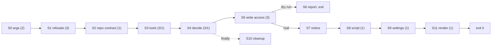
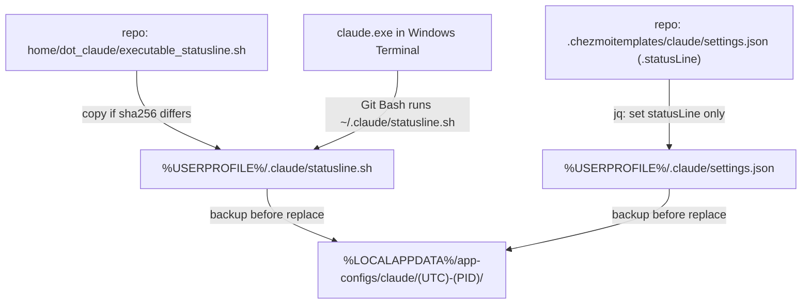

# T-0052 Claude Code status line on native Windows: execution plan

- **Status:** design reviewed (independent review PASS WITH NOTES, round 3); implementation not started
- **Work id:** T-0052-windows-claude-statusline (`Source: local`, per [ticket.md](ticket.md))
- **Designed against:** `400a30b` (main), plus another session's uncommitted step C work (P0)
- **Date:** 2026-11-15
- **ADR:** [0016](../../../architecture/decisions/0016-native-windows-claude-status-line.md)

## Context

- Request: automate the Claude Code status line for native Windows Claude in Windows Terminal. WSL Claude already has it through chezmoi.
- Tickets and ADR: see [ticket.md](ticket.md) for the request, acceptance criteria (AC1 to AC29, N1 to N4), decisions D1 to D8 and risks R1 to R9.
- Standing goals: reproducible setup, verified, short docs with Mermaid. A Windows PowerShell bootstrap is allowed.
- Evidence behind the design:
  - The template `home/.chezmoitemplates/claude/settings.json` is plain JSON (no `{{`), eol=lf. `*.sh` files are eol=lf (`.gitattributes`).
  - The script `home/dot_claude/executable_statusline.sh` ran unchanged under Git Bash 5.3 with jq 1.8.2: 12 cases exit 0, about 0.6 s per run against refreshInterval 5.
  - jq 1.8.2 accepts a UTF-8 BOM, writes LF output with `--binary`, keeps raw UTF-8 and long integer literals. Exit codes: 2 missing or unreadable input, 5 parse error, 4 empty input, 1 false, 0 for a BOM-prefixed file.
  - `width()` counts display columns from bytes. The locale only switches separators (`│·█░` against `|-#-`).
- Claude Code on Windows runs the documented command `~/.claude/statusline.sh` through Git Bash.

## Decision

Add an opt-in step S to `ops/windows/bootstrap.ps1`, run by a new switch `-ClaudeStatusLine`.

- It installs the unchanged repo script `home/dot_claude/executable_statusline.sh` as `%USERPROFILE%\.claude\statusline.sh`.
- It installs jq through winget when jq is missing.
- It sets exactly one key in `%USERPROFILE%\.claude\settings.json`: `statusLine`, equal to `.statusLine` read at run time from the template.
- The default full run does not include step S. Its output stays byte-identical, including the closing NOTICE.
- Updates reach Windows when you re-run `-ClaudeStatusLine` after `git pull`. `-ClaudeStatusLine -DryRun` is the drift check.

Rejected alternatives (also in ADR-0016):

| Option | Reason |
|---|---|
| A: chezmoi on Windows, limited to the Claude files | No Windows rules exist, so a plain apply deploys about a dozen Unix dotfiles. Limiting it needs an ignore-everything-else list that every new home/ file must be checked against, an unbounded burden. Whether a bash `modify_` script runs without `interpreters` is unknown. The template would push hooks, model and theme, and the Linux `modify_` overwrites invalid JSON. The mechanism is rejected, but its capability (a single source) is kept because step S reads the same repo files. |
| C: a native PowerShell status line | A second implementation of a 592-line script with no parity tests (bats does not run on Windows) and no speed gain. |
| E: point statusLine.command at the repo checkout file | No drift, but it ties Claude to whatever branch is checked out and to the clone path, and needs a Windows-only command value, which is a second source. |
| Include step S in the default full run | It couples a cosmetic step to the WSL exit codes and widens what the default run writes. Deferred (D2). |
| ConvertTo-Json merge | PS 5.1 reformats, escapes `<>'&` and limits depth. jq is needed anyway. |
| Recursive merge `. * {statusLine:...}` (Linux parity) | Keys inside an old statusLine would survive. Windows replaces the value exactly. |

## Scope

Windows gets:

- `{"statusLine":{"type":"command","command":"~/.claude/statusline.sh","padding":2,"refreshInterval":5}}`, copied from the template at run time.
- `%USERPROFILE%\.claude\statusline.sh`.
- The winget package `jqlang.jq`.

Windows does not get:

- `hooks`: PreToolUse fires on every tool call, so a bash or jq failure would block every tool. The Stop hooks use POSIX `[ -f ] &&` and `~/Projects/ai-monitoring`. ADR-0006 limits Windows Claude to Windows-side work.
- `model` and `theme`: per-side choices, and `~/.claude` is separate on each side.
- `subagentStatusLine`: removed in Claude Code 2.1.323.
- `env`, including LANG (D5), and `CLAUDE_CODE_GIT_BASH_PATH`: Claude finds bash from git on PATH. S3 only reports it.

Non-goals: installing Claude Code, chezmoi on Windows, changing the statusline script or the Linux template, a Nerd Font, Windows Terminal profile settings, automatic updates.

## Prerequisite P0

The other session's uncommitted step C work in `ops/windows/bootstrap.ps1` (`Resolve-GitBash`, `Invoke-HooksInstallerFlow`, `Invoke-BootstrapRun`, the NOTICE wrapper) is committed by its owner.
Never stage it. If it is abandoned, stop and re-plan; do not duplicate it.

## Step S: the authoritative sequence

Names:

- `$T` is the repo template.
- `$ClaudeDir = Join-Path $env:USERPROFILE '.claude'`, computed at the start of `Invoke-BootstrapRun` next to `$StateRoot`.
- `$S = $ClaudeDir\settings.json` and `$P = $ClaudeDir\statusline.sh`.
- `$B = $StateRoot\claude\<Get-UtcStamp>-<$PID>`.
- A temp file is `<target>.app-configs-tmp-<$PID>`, created with `FileMode.CreateNew`, so it never overwrites an existing file.
- Every jq call goes through `Invoke-Jq`.
- The dry run stops at the same points with the same exit codes unless a step says otherwise.
- Every message is `Say "step S: ..."`. Each native call that can block is preceded by `Start-Wait`.

Exit codes: 0 done, 1 failure, 2 bad arguments, 3 refusal or human step (the same meaning as the rest of the script).

**S0 Arguments.**

- `-ClaudeStatusLine` combined with `-ToolsOnly`, `-Export`, `-Report` or `-EnableSystemRestore` exits 2.
- The switch goes into four places: the script param block, `Invoke-Bootstrap`, `Invoke-BootstrapRun`, and `.DESCRIPTION` (usage line and text).

**S1 Refusals (nothing is written).**

- An elevated run exits 3.
- `Get-EnvScopes 'CLAUDE_CONFIG_DIR'` returns a value in the Process, User or Machine scope: exit 3.
- `$ClaudeDir`, `$S` or `$P` exists and is a reparse point (`(Get-Item -Force).Attributes -band ReparsePoint`): exit 3.

**S2 Repo contract.**

- The `$T` text contains `{{`: exit 1.
- `Get-TemplateStatusLine $T` (ConvertFrom-Json) fails: exit 1.
- `.type` is not `command`, or `.command` is not `~/.claude/statusline.sh`: exit 1.
- Read the source script bytes once and compute `$srcHash = Get-BytesSha256 $bytes`. A `0x0D` byte in them: exit 1.

**S3 Tools.**

- Git Bash:
  - `Resolve-GitBash` returns `$null`: exit 3.
  - `Get-GitBashHome $bash` fails or prints nothing: exit 1.
  - The Git Bash home is not equal to `USERPROFILE`: exit 3. The comparison ignores case and strips a trailing `\` or `/` on both sides. The message names both paths.
- `CLAUDE_CODE_GIT_BASH_PATH` set in any scope (`Get-EnvScopes`) is reported with its value and the note "Claude Code uses this bash". It never stops the run.
- Claude Code: `Get-ToolVersion -Name claude -VersionArgs @('--version')`, falling back to `Test-Path "$env:USERPROFILE\.local\bin\claude.exe"` ("found but not on PATH"). Reported only, never stops the run.
- jq is missing:
  - Dry run: print "would run: winget install --id jqlang.jq --exact --source winget --accept-package-agreements --disable-interactivity". The version and the settings plan become unknown.
  - Real run: `Install-WingetTools -Step 'S'` with the tool entry `@{ Name='jq'; Id='jqlang.jq'; VersionArgs=@('--version') }` (same shape as the step C entries). Source agreements needed: exit 3, printing the command. Install failed or jq still not found: exit 1. After a successful install, say that sessions started earlier do not see jq and that Windows Terminal must be reopened.
- jq version: parse `^jq-(\d+\.\d+(\.\d+)?)`. Below 1.7, or unparseable: exit 3, naming `Resolve-Program jq`.

**S4 Decide what needs writing.** In this phase, only `$B` is written.

- Script: a write is needed when `$P` is absent or `Get-Sha256 $P` differs from `$srcHash`.
- Real run: create `$StateRoot\claude` with `New-Item -ItemType Directory -Force`, then `$B` with `New-Item -ItemType Directory` (no `-Force`, no Test-Path first). If that fails: exit 1, "backup folder already exists". Cleanup S10 is armed from here on (try/finally).
- `$S` absent: the plan is "create". Skip validation and the current check.
- `$S` present:
  1. `[IO.File]::ReadAllBytes`. If that fails: exit 3, "cannot read settings.json".
  2. Strip a UTF-8 BOM and decode with `New-Object Text.UTF8Encoding($false,$true)`. If that fails: exit 3, "not UTF-8". When the bytes start with `FF FE` or `FE FF`, the message is "not UTF-8 (UTF-16?)".
  3. Real run: write the same bytes to `$B\settings.json` (the snapshot, created CreateNew) and set `$snapHash = Get-BytesSha256 $bytes`. `$SNAP` is the snapshot. Dry run: `$SNAP = $S`, read-only.
  4. Validate with `jq -e -s 'length == 1 and (.[0] | type == "object")' $SNAP`. Return code 1, 2, 4 or 5: exit 3 ("not one JSON object", "cannot read" for 2). Any other non-zero code: exit 1.
  5. Current check: `jq -e --slurpfile t $T '.statusLine == $t[0].statusLine' $SNAP`. 0 means current, 1 means a write is needed, anything else exits 1. If the statusLine differs, report its old `command`.
- Dry run without jq: settings show as "unknown without jq".
- Report leftover `*.app-configs-tmp-*` files in `$ClaudeDir` ("left over from an earlier run; delete by hand"). They are never deleted and never stop the run.

**S5 Write-access preflight.** Runs in both modes, only for targets that need writing and already exist.

- The ReadOnly attribute is set: exit 3, "clear the read-only attribute".
- `[IO.File]::Open($p,'Open','ReadWrite','ReadWrite').Dispose()` throws: exit 3.
- A current target is never checked. The probe writes nothing.

**S6 End of dry run.** Print the plan, listing only the targets that would be written plus "would render once", then exit 0 (or the code of an earlier stop). An unknown caused by missing jq gives exit 0 and says so.

**S7 Notice (real run).** Print "close running Windows Claude Code sessions first" and list the targets that will be written. A notice only; there is no process detection (AGENTS.md).

**S8 Write the script (if needed).**

1. Create `$ClaudeDir` if it is missing.
2. If `$P` exists, copy it with `[IO.File]::Copy($P, "$B\statusline.sh", $false)`.
3. Write the bytes read in S2 to the temp file (CreateNew).
4. `Get-Sha256 <temp>` must equal `$srcHash`. Otherwise delete the temp file and exit 1.
5. If `$P` exists, `[IO.File]::Replace(<temp>, $P, [NullString]::Value)`. Otherwise `Move-Item -LiteralPath <temp> -Destination $P` without `-Force`.
6. Any exception: delete the temp file and exit 1. The script backup is kept.

**S9 Write the settings (if needed).**

- Existing `$S`:
  1. Run `jq --binary --slurpfile t $T '.statusLine = $t[0].statusLine' $SNAP` and write stdout to the temp file as UTF-8 without a BOM (CreateNew).
  2. Verify the temp file: `jq -e -s --slurpfile o $SNAP --slurpfile t $T 'length == 1 and (.[0].statusLine == $t[0].statusLine) and ((.[0] | del(.statusLine)) == ($o[0] | del(.statusLine)))' <temp>`. Non-zero: delete the temp file and exit 1.
  3. Immediately before the replace, `Get-Sha256 $S` must equal `$snapHash`. Otherwise delete the temp file and exit 1, "settings.json changed during the run".
  4. `[IO.File]::Replace(<temp>, $S, [NullString]::Value)`.
- Absent `$S`:
  1. Run `jq --binary -n --slurpfile t $T '{statusLine: $t[0].statusLine}'` and write it to the temp file.
  2. Verify with `jq -e -s --slurpfile t $T 'length == 1 and .[0] == {statusLine: $t[0].statusLine}' <temp>`.
  3. Immediately before the move, `Test-Path -LiteralPath $S` must still be false. Then `Move-Item` without `-Force`.
  4. If the file appeared, or the move throws an IOException: delete the temp file and exit 1, "settings.json appeared during the run".
- Any other exception: delete the temp file and exit 1.

**S11 Render check.** Runs in every real run that reaches it, including when everything was current.

- Write the payload to `$B\payload.json` (CreateNew).
- Call `Invoke-StatusLineRender $bash <payload, forward slashes>`, which runs `Invoke-Native -ExePath $bash -Arguments @('-c','STATUSLINE_GIT_TTL=0 ~/.claude/statusline.sh < "$1"','_',<payload>)`.
- It needs exit 0 and at least one non-empty line. Otherwise exit 1, showing the first stderr line.
- On success: "done; reopen Windows Terminal, then start claude", exit 0.

**S10 Cleanup.** The finally block, run on success and on every stop once `$B` exists, before the exit code is returned. It never changes the exit code.

1. Delete `$B\payload.json`.
2. Delete `$B\settings.json` unless S9 replaced or created `$S`.
3. Run `Remove-Item -LiteralPath $B` (no `-Recurse`) only if `$B` is empty.
4. Remove `$StateRoot\claude` the same way, only if it is empty.

A `$B` that is kept holds only real backups.

## Seams and helpers

New seams go into `$SeamNames`, and those with parameters into `$Sigs` in the tests:

- `Get-EnvScopes([string]$Name)` returns `@{Process; User; Machine}`.
- `Get-GitBashHome([string]$Bash)` calls `Invoke-Native` with `@('-c','cygpath -w ~')`, a 30 s timeout, and returns the first trimmed line.
- `Invoke-Jq([string[]]$Arguments)` calls `Invoke-Native` on `Resolve-Program 'jq'` with a 60 s timeout.
- `Invoke-StatusLineRender([string]$Bash, [string]$PayloadPath)` uses the exact argument array from S11 with a 30 s timeout.
- `Get-TemplateStatusLine([string]$Path)` wraps `ConvertFrom-Json`, which is not on the static allowlist.

New pure helpers (not seams):

- `Get-BytesSha256([byte[]]$Bytes)` returns lowercase hex, the same format as `Get-Sha256`.
- `Install-WingetTools([string]$Step, [object[]]$Tools)` is extracted from step C, returns 0, 1 or 3, and keeps step C messages byte-identical. Each tool entry is `@{ Name; Id; VersionArgs }`; step S passes `@{ Name='jq'; Id='jqlang.jq'; VersionArgs=@('--version') }`.
- `Invoke-ClaudeStatusLine` implements S1 to S11 and returns 0, 1 or 3.

Existing seams reused: `Resolve-GitBash`, `Resolve-Program`, `Get-ToolVersion`, `Invoke-Winget`, `Get-WingetInstallArgs`, `Update-SessionPath`, `Get-Sha256`, `Get-UtcStamp`, `Test-IsAdmin`.

Static S1 allowlist (tests): only `ForEach-Object, Where-Object, Select-Object, Sort-Object, Join-Path, Split-Path, Test-Path, Get-ChildItem, Get-Item, New-Item, Move-Item, Remove-Item, New-Object, Write-Host` may appear outside seams.

- There is no Copy-Item: use `[IO.File]::Copy`.
- `ConvertFrom-Json` lives inside `Get-TemplateStatusLine`.
- Every native call goes through a seam.
- The script stays ASCII-only.

## Test isolation

- Every CS case runs with:
  - `USERPROFILE`, `LOCALAPPDATA` and `HOME` pointing at folders under `$TestTmp`, with `HOME` equal to the redirected `USERPROFILE`. Git Bash otherwise derives home from HOMEDRIVE+HOMEPATH, which is the real profile.
  - `CLAUDE_CONFIG_DIR` removed.
  - Everything restored afterwards. `HOME` is removed again because it is unset on this PC.
- Unit cases stub `Get-EnvScopes` and `Get-GitBashHome`, the latter returning the redirected `USERPROFILE`. They use the real `Get-Sha256` (not the default throwing stub).
- Suite guard:
  - Before the first test, record the SHA-256 or the absence of the real `%USERPROFILE%\.claude\settings.json` and `statusline.sh`, and whether `%LOCALAPPDATA%\app-configs\claude` exists.
  - After the last test, fail the suite on any difference.
- Dry-run test: the redirected `USERPROFILE` and `LOCALAPPDATA` trees list the same files with the same hashes before and after.
- Real-jq cases are skipped when jq 1.7+ is not resolvable. Real Git Bash cases are skipped without Git Bash. Both run on this PC.

Suite command: `powershell -NoProfile -ExecutionPolicy Bypass -File tests\windows\bootstrap.tests.ps1`.
bats does not run on Windows.

## Documentation to write later (T5)

- ADR-0016 status becomes "decided, not yet verified" in T5. It is "proposed" until then.
- `docs/platforms/windows/setup.md`: a new section "4b. Claude status line" after section 4:
  - Run `powershell -NoProfile -ExecutionPolicy Bypass -File ops\windows\bootstrap.ps1 -ClaudeStatusLine -DryRun`, then the same command without `-DryRun`.
  - Four bullets on what it does (jq, script, the statusLine key only, render check).
  - Update: after `git pull`, `-DryRun` shows drift; re-run to apply.
  - Rollback: copy the files back from `%LOCALAPPDATA%\app-configs\claude\<UTC>-<PID>\`, or run `jq --binary 'del(.statusLine)'` into a temp file, replace settings.json with it, and delete `statusline.sh`; optionally `winget uninstall --id jqlang.jq --exact`.
  - Troubleshooting: reopen Windows Terminal (PATH); accept workspace trust for the folder; `disableAllHooks: true` also disables the status line; Claude Code may use another bash (`CLAUDE_CODE_GIT_BASH_PATH`, PATH order) or start in a different environment; `claude --debug`.
  - The Mermaid flow below.
- `docs/platforms/wsl/windows-and-wsl.md`, one bullet under "Where to run Claude Code": "Windows Claude gets only the repo status line (`bootstrap.ps1 -ClaudeStatusLine`); no hooks, model or theme."
- `bootstrap.ps1` `.DESCRIPTION`: the switch, its exclusivity, exit codes 0, 1, 2 and 3, the refusals (elevated, CLAUDE_CONFIG_DIR, Git Bash home mismatch, reparse point, read-only), and that the default run does not include step S.

## Tasks

Committing needs separate authorisation (AGENTS.md); use one conventional commit per slice.

- [ ] **T1: record the decision (ticket and ADRs)**
  - Progress: records written and reviewed (PASS WITH NOTES); pre-commit and commit pending.
  - Collision check (2026-11-15): `grep -rln T-0052 docs` found only the new and modified files; `git grep` on all refs found no other T-0052; single worktree; highest existing folder is T-0051.
  - Files: T-0052 ticket.md and plan.md, docs/work/index.md, ADR-0016 (as "proposed"), ADR-0002, ADR-0006, decisions/index.md, T-0047 plan.md (Milestone 2 bullet).
  - Depends on: none.
  - Acceptance: AC13 (records part).
  - Risk: low.
  - Review before T2: the collision check was run; the boundary and removal trigger are present; D1 to D8 recorded.
  - Verify: the pre-commit hook passes; inspection.
- [ ] **T2: extract Install-WingetTools from step C**
  - Files: ops/windows/bootstrap.ps1, tests/windows/bootstrap.tests.ps1.
  - Depends on: P0, T1.
  - Acceptance: N1, AC8 (helper).
  - Risk: medium.
  - Review: the step C transcript is byte-identical; no assertion edited; the suite is green.
  - Verify: the full tests/windows suite.
- [ ] **T3: step S skeleton and script install**
  - Covers S0 to S3, the S4 script part and the `$B` lifecycle, S5, S6 to S8 and S10. Adds the seams Get-EnvScopes, Get-GitBashHome, Get-TemplateStatusLine and Invoke-StatusLineRender, the helper Get-BytesSha256, and the switch in all four places.
  - Files: bootstrap.ps1, bootstrap.tests.ps1.
  - Depends on: T2.
  - Acceptance: AC1, AC2, AC6, AC7, AC8, AC9, AC12, AC18 (script part), AC19, AC20, AC21, AC22, AC23, AC27 (script part), AC28, AC29, N4.
  - Risk: medium.
  - Build order: the test isolation harness and suite guard first.
  - Review: every stop matches the step S sequence; cleanup is non-recursive and `$B` uses no `-Force`; the guard fails on a deliberate change to a real file (shown once, then reverted); there is no Copy-Item or ConvertFrom-Json outside a seam.
  - Verify: the full suite.
- [ ] **T4: settings merge and render check**
  - Covers the settings parts of S4 and S5, S9, S11 and Invoke-Jq. Adds the real-jq and real Git Bash cases.
  - Files: bootstrap.ps1, bootstrap.tests.ps1.
  - Depends on: T3.
  - Acceptance: AC3, AC4, AC5, AC10, AC14, AC15, AC16, AC17, AC18 (settings part), AC24, AC25, AC26, AC27, N3.
  - Risk: high.
  - Review: every stop before S8 leaves `$P`, `$S` and the redirected `$StateRoot` unchanged; the temp file is verified before the replace; the AC25 proof fails if pointed at the real home; the real-jq and real Git Bash cases ran (not skipped) on this PC.
  - Verify: the full suite.
- [ ] **T5: documentation**
  - Files: docs/platforms/windows/setup.md (4b), docs/platforms/wsl/windows-and-wsl.md, ADR-0016 status set to "decided, not yet verified", bootstrap.ps1 `.DESCRIPTION`.
  - Depends on: T4.
  - Acceptance: AC13, N2.
  - Risk: low.
  - Review: the docs match the section "Documentation to write later" and the Mermaid blocks parse.
  - Verify: inspection; `git diff --stat main -- home nix ops/*.sh` is empty.
- [ ] **T6: real run on this PC and evidence**
  - Files: the T-0052 evidence note only (`evidence/`).
  - Depends on: T5.
  - Acceptance: AC1, AC2, AC3, AC4, AC7 and AC10 live, then AC11.
  - Risk: medium (it writes the real settings.json, with a backup).
  - Needs the user's explicit go-ahead for this task before it starts (a winget install and writes to the real settings.json), the same as committing.
  - Steps:
    1. Record the sha256 of the real settings.json.
    2. Run `-ClaudeStatusLine -DryRun` and record the exit code; confirm nothing was written.
    3. Real run: exit 0.
    4. Compare the backup's sha256 with step 1.
    5. Run the AC3 and AC4 jq checks.
    6. Compare `Get-FileHash` of `$P` and the repo script.
    7. A second real run says "current" and makes no new `$B`.
    8. H1.

## Human check H1

- Precondition: a T6 real run exited 0.
- Steps: close every Windows Terminal window, open a new one (PowerShell profile), `cd` into the repo, run `claude`.
- Expected within about 5 s under the prompt:
  - row 1 shows `app-configs`, the branch and the model;
  - row 2 starts with `Ctx`;
  - separators are `|` (ASCII while LANG is unset) or `│`.
- Record:
  - the separator kind;
  - any tofu glyphs;
  - whether a window under 80 columns switches to the minimal layout;
  - whether `CLAUDE_CODE_GIT_BASH_PATH` was reported in S3.
- If nothing shows:
  - check workspace trust and `disableAllHooks`;
  - then run `claude --debug` and look for the statusline error (jq not found means a stale PATH; otherwise a bash path or home problem).
- Write the result into the T-0052 evidence note and set ADR-0016 to verified.

## Rollback

- Windows: the setup.md 4b rollback text (see above): restore from `$B`, or remove the `statusLine` key with jq and delete `statusline.sh`; optionally `winget uninstall --id jqlang.jq --exact`.
- Repo: revert the T-0052 commits.
